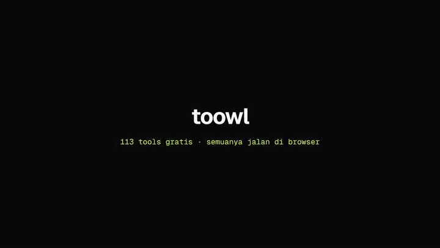
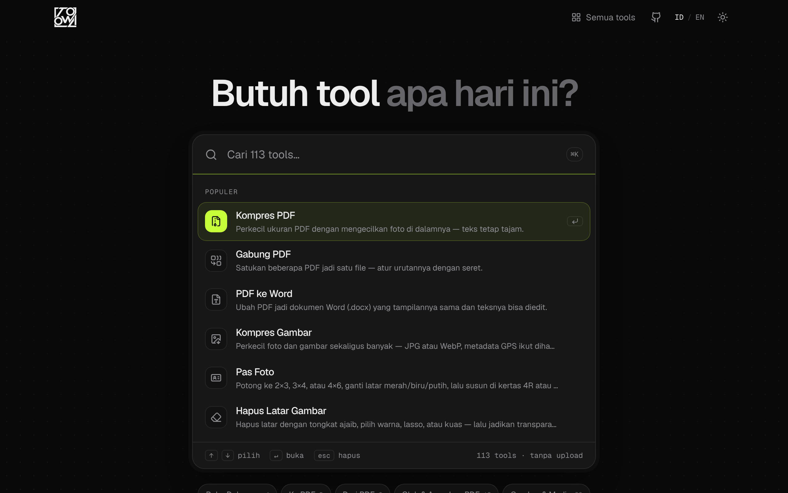
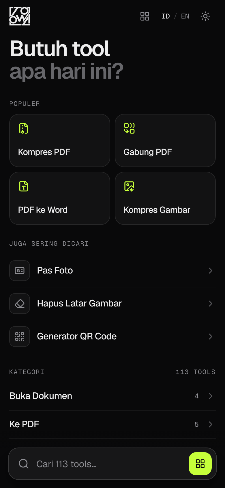

# toowl

[English](README.md) · **Bahasa Indonesia**

Kotak perkakas file sehari-hari: **130 tools gratis** untuk PDF, Office, gambar
CAD, foto, video, audio, musik, dan hitungan sehari-hari yang jalan **sepenuhnya
di browser**. File diproses di perangkat pengguna: tidak di-upload ke server dan
tidak disimpan di mana pun.

**Live:** https://toowl.my.id/

<a href="https://toowl.my.id/"></a>

▶ [Tonton video pengenalan 30 detik (MP4)](docs/intro-id.mp4) · [Versi English](docs/intro-en.mp4)

<p>
  
  
</p>

Tersedia dalam **Bahasa Indonesia dan English** — ganti lewat tombol ID/EN di
header (atau lewat alamatnya: `/en/<tool>/` selalu English).

## Pasang di situsmu

Setiap tool boleh dipasang di website-mu sendiri, gratis. Tool tetap berjalan
di browser pengunjungmu, tanpa server. Lewat iframe, situsmu tidak ikut terikat
lisensi apa pun. Kalau memakai paket npm-nya, berlaku lisensi
[AGPL-3.0](#lisensi) (lihat di bawah).

**1. Iframe (semua tool, bisa dipakai sekarang).** Ganti `screen-recorder`
dengan alamat tool mana pun dari tabel di bawah, misalnya `whiteboard`,
`compress-image`, atau `qr-generator`:

```html
<iframe
  src="https://toowl.my.id/#/screen-recorder?embed"
  title="Rekam Layar"
  style="width: 100%; height: 760px; border: 0; border-radius: 16px"
  allow="display-capture; microphone; camera; clipboard-write; fullscreen; picture-in-picture"
></iframe>
```

`?embed` menampilkan tool saja, tanpa header dan footer. Tambahkan
`&theme=light` atau `&theme=dark` untuk memaksa tema. Atribut `allow` hanya
dibutuhkan oleh tool yang memakai layar, mikrofon, atau kamera. Kode siap salin
juga ada di bagian **Pasang di situsmu** di halaman setiap tool.

**2. Paket npm / satu tag script** (dimulai dari Rekam Layar,
[`@chalidade/screen-recorder`](packages/screen-recorder)): elemen
`<screen-recorder>` yang gayanya terisolasi (Shadow DOM), bisa diatur warnanya,
dan mengirim event berisi file rekaman. Ada juga API tanpa UI untuk developer.

```html
<script type="module" src="https://cdn.jsdelivr.net/npm/@chalidade/screen-recorder@0/dist/element.js"></script>
<screen-recorder theme="auto"></screen-recorder>
```

> Paket npm-nya sedang menunggu diterbitkan. Sampai saat itu, pakai iframe di
> atas. Cara kerja, build, dan cara menambah paket untuk tool lain ada di
> [packages/README.md](packages/README.md).

## Daftar tools

| Tool | Alamat | Keterangan |
| --- | --- | --- |
| Baca PDF | [`/pdf-reader/`](https://toowl.my.id/pdf-reader/) | Halaman digambar pdf.js + lapisan teks (bisa diseleksi, disalin, dicari dengan Ctrl+F), link aktif, PDF berpassword, zoom, lompat halaman, layar penuh. |
| Baca Word | [`/word-reader/`](https://toowl.my.id/word-reader/) | `.docx` per halaman (docx-preview), zoom, layar penuh. |
| Baca Excel | [`/excel-reader/`](https://toowl.my.id/excel-reader/) | `.xlsx`/`.csv` sebagai grid dengan huruf kolom, nomor baris, dan tab sheet; format angka, warna, border, sel gabungan. |
| Baca PowerPoint | [`/ppt-reader/`](https://toowl.my.id/ppt-reader/) | Slide `.pptx` sesuai tata letaknya, plus mode presentasi satu slide per layar. |
| Word ke PDF | [`/doc-to-pdf/`](https://toowl.my.id/doc-to-pdf/) | `.docx` → PDF (docx-preview + jsPDF). `.doc` lama belum didukung. |
| PDF ke Word | [`/pdf-to-word/`](https://toowl.my.id/pdf-to-word/) | PDF → `.docx` yang bisa diedit (pdf.js + docx). Teks, ukuran, tebal/miring, font, tab, dan pemisah halaman ikut; gambar dan garis tabel tidak. PDF hasil scan belum didukung (butuh OCR). |
| DWG ke PDF | [`/dwg-to-pdf/`](https://toowl.my.id/dwg-to-pdf/) | DWG (R14–2018) atau DXF → PDF vektor. Dibaca dengan LibreDWG versi WebAssembly (`@mlightcad/libredwg-web`, GPL-3.0, ±8 MB, dimuat saat tool dipakai), digambar sendiri: blok, dimensi, hatch berpola, tipe garis, ketebalan garis, ByLayer/ByBlock. Kertas A4–A0, pas kertas atau skala 1:N, warna asli atau hitam, layer bisa dimatikan. Model space saja. |
| Gambar ke PDF | [`/image-to-pdf/`](https://toowl.my.id/image-to-pdf/) | JPG/PNG/WebP/GIF/BMP → satu PDF (jsPDF). Banyak gambar sekaligus, urutan bisa diatur, putar 90°, ukuran A4/Letter/sesuai gambar, orientasi, margin. Rotasi EXIF foto ponsel ikut. HEIC hanya terbaca di Safari. |
| PowerPoint ke PDF | [`/ppt-to-pdf/`](https://toowl.my.id/ppt-to-pdf/) | `.pptx` → PDF, satu halaman per slide (@jvmr/pptx-to-html + jsPDF, HTML slide disanitasi dengan DOMPurify). Teks, bentuk, tabel, grafik, dan gambar ikut; animasi, transisi, dan video tidak. `.ppt` lama belum didukung. |
| Markdown & Teks ke PDF / Word | [`/markdown-to-pdf/`](https://toowl.my.id/markdown-to-pdf/) | Tulis atau buka `.md`/`.txt`, lihat pratinjau halaman (A4/Letter, margin, huruf), lalu unduh PDF (halaman berupa gambar, atau teks bisa diseleksi lewat Cetak) atau DOCX dengan judul, daftar, tabel, dan kode asli (marked + DOMPurify, memakai ulang mesin halaman Word ke PDF). Gambar dari internet tidak pernah dimuat. |
| Excel ke PDF | [`/excel-to-pdf/`](https://toowl.my.id/excel-to-pdf/) | `.xlsx`/`.csv` → PDF tabel dengan teks yang bisa diseleksi (ExcelJS + numfmt + jsPDF autotable). Warna (termasuk warna tema), tebal/miring, border, sel gabungan, format angka/tanggal/persen, teks terbungkus; baris/kolom/sheet tersembunyi dilewati. Pilihan kertas, orientasi, muat-ke-lebar atau ukuran asli, garis bantu, dan sheet mana yang dicetak. `.xls`/`.ods` belum didukung; huruf di luar Latin (mis. aksara CJK) belum tampil benar karena PDF memakai font Helvetica bawaan. |
| PDF ke Excel | [`/pdf-to-excel/`](https://toowl.my.id/pdf-to-excel/) | Tabel di PDF → `.xlsx` (pdf.js + ExcelJS). Baris dari garis dasar teks, kolom dari celah vertikal yang kosong; sel yang terbungkus digabung kembali; header yang berulang tiap halaman diambil sekali. Angka (Rp, ribuan, desimal koma/titik, persen, negatif dalam kurung) jadi angka sungguhan dengan format Excel; nomor berawalan 0 tetap teks. Satu sheet gabungan atau satu per halaman. PDF hasil scan belum didukung. |
| PDF ke PowerPoint | [`/pdf-to-ppt/`](https://toowl.my.id/pdf-to-ppt/) | Tiap halaman PDF → satu slide `.pptx` seukuran halaman (pdf.js + pptxgenjs). Mode **teks bisa diedit**: latar slide = halaman tanpa teks (bentuk, warna, gambar), teks jadi kotak teks di posisi aslinya dengan ukuran, tebal/miring, font, dan warna (warna dibaca dari selisih piksel render dengan/tanpa teks). Mode **persis seperti PDF**: tiap slide berupa gambar halaman. |
| PDF ke DWG | [`/pdf-to-dwg/`](https://toowl.my.id/pdf-to-dwg/) | Garis, kurva (lingkaran tetap lingkaran), dan teks vektor PDF → DXF R12 (pdf.js operator list). Skala 1:N dan satuan mm/cm/m, beberapa halaman berjajar di satu file, layer PDF_GARIS/PDF_TEKS/PDF_ISIAN/PDF_HALAMAN. Buka di AutoCAD lalu Save As .dwg; DWG langsung tidak ditulis karena belum ada penulis DWG yang andal di browser. |
| PDF ke Gambar | [`/pdf-to-image/`](https://toowl.my.id/pdf-to-image/) | Halaman PDF → PNG/JPG pada 72/150/300 dpi (pdf.js). Pilih halaman lewat pratinjau; satu halaman jadi gambar, beberapa jadi ZIP (jszip). |
| Gabung PDF | [`/merge-pdf/`](https://toowl.my.id/merge-pdf/) | Beberapa PDF → satu PDF (pdf-lib). Urutan diatur dengan seret atau tombol kiri/kanan; pratinjau halaman pertama dan jumlah halaman tiap file. |
| Pisah PDF | [`/split-pdf/`](https://toowl.my.id/split-pdf/) | Ambil halaman terpilih jadi satu PDF, pisah per rentang (`1-3, 5, 8-`), atau pecah tiap N halaman (pdf-lib). Lebih dari satu hasil diunduh sebagai ZIP. |
| Watermark PDF | [`/watermark-pdf/`](https://toowl.my.id/watermark-pdf/) | Teks atau gambar/logo di semua halaman (pdf-lib): satu di tengah atau berulang, diagonal/mendatar, ukuran, warna, ketebalan; pratinjau memakai perhitungan tata letak yang sama dengan PDF-nya. Halaman yang diputar ikut benar. Teks memakai Helvetica bawaan, jadi hanya huruf Latin. |
| Atur Halaman PDF | [`/organize-pdf/`](https://toowl.my.id/organize-pdf/) | Thumbnail semua halaman; seret atau pakai tombol untuk mengubah urutan, putar kiri/kanan, duplikat, dan hapus halaman, lalu simpan jadi PDF baru (pdf.js untuk pratinjau, pdf-lib untuk menyusun). |
| Nomor Halaman PDF | [`/page-numbers/`](https://toowl.my.id/page-numbers/) | Nomor di enam posisi (atas/bawah × kiri/tengah/kanan), format `1`, `1 / 10`, `Halaman 1`, atau `- 1 -`, halaman awal dan nomor pertama bisa diatur (sampul dilewati). Halaman yang diputar ikut benar (pdf-lib). |
| Isi Formulir PDF | [`/fill-pdf/`](https://toowl.my.id/fill-pdf/) | Kenali kolom AcroForm (teks, centang, pilihan, tombol radio), isi di samping pratinjau halaman, lalu simpan; opsi “ratakan” mengunci isiannya. Formulir XFA tidak didukung dan dikatakan jelas (pdf-lib). |
| Cetak Hemat Kertas | [`/pdf-n-up/`](https://toowl.my.id/pdf-n-up/) | 2, 4, atau 8 halaman per lembar, atau susunan buku yang tinggal dilipat, di kertas A4, F4, atau Letter. Halaman disematkan (`embedPage`), jadi teks tetap tajam; halaman yang diputar ikut benar. |
| ZIP: Buat & Buka | [`/zip/`](https://toowl.my.id/zip/) | Gabungkan file atau folder jadi ZIP (tanpa/biasa/maksimal), atau buka ZIP dan ambil isinya satu per satu. Memakai JSZip, semua di browser. |
| Ekstrak Gambar dari PDF | [`/pdf-extract-images/`](https://toowl.my.id/pdf-extract-images/) | Ambil semua gambar tertanam; JPEG disimpan apa adanya, sisanya PNG (dengan transparansi); unduh satuan atau ZIP. JPEG 2000/JBIG2 dilewati. |
| Tanda Tangan PDF | [`/sign-pdf/`](https://toowl.my.id/sign-pdf/) | Gambar tanda tangan (mouse, jari, atau pena dengan tekanan) atau unggah fotonya — latar kertas dijadikan transparan — lalu tempel, geser, dan ubah ukurannya di halaman mana pun (pdf-lib). Tanda tangan berupa gambar, bukan TTE bersertifikat. |
| PDF Hemat Tinta | [`/pdf-grayscale/`](https://toowl.my.id/pdf-grayscale/) | Ubah PDF jadi abu-abu atau hitam-putih (ambang bisa diatur, latar terang jadi putih) sebelum dicetak. Halaman dirender ulang jadi gambar, jadi teksnya tidak bisa dipilih lagi. |
| Edit PDF | [`/edit-pdf/`](https://toowl.my.id/edit-pdf/) | Tambah teks (font, ukuran, warna), gambar, kotak, garis, centang, dan coretan di halaman mana pun untuk formulir yang bukan AcroForm; pratinjau dan penempatan memakai ruang halaman yang sama dengan hasilnya, halaman yang diputar ikut benar (pdf-lib). Kotak isi penuh hanya menutup tampilan, bukan menyensor. |
| Kompres PDF | [`/compress-pdf/`](https://toowl.my.id/compress-pdf/) | Foto JPEG di dalam PDF diperkecil dan dikodekan ulang (Ringan/Sedang/Kuat), lalu struktur PDF dioptimasi dengan qpdf (object stream, rekompresi). Teks tetap teks. Gambar non-JPEG/CMYK tidak disentuh; hasil tidak pernah lebih besar dari aslinya. |
| PDF ke Markdown | [`/pdf-to-markdown/`](https://toowl.my.id/pdf-to-markdown/) | Judul dari ukuran huruf, **tebal**/*miring*, daftar, dan tabel Markdown (mesin tabel PDF ke Excel + mesin paragraf PDF ke Word); tabel yang bersambung antar-halaman digabung. |
| Redaksi PDF | [`/redact-pdf/`](https://toowl.my.id/redact-pdf/) | Seret di atas halaman untuk menandai area; halaman yang ditandai dirender ulang jadi gambar dengan area itu dihitamkan, jadi teks aslinya benar-benar hilang (bukan cuma tertutup). Teks di halaman itu tidak bisa disalin lagi; halaman lain tetap utuh. |
| Proteksi PDF | [`/protect-pdf/`](https://toowl.my.id/protect-pdf/) | Password buka + izin cetak/salin/ubah, enkripsi AES-256 (qpdf). |
| Buka Proteksi PDF | [`/unlock-pdf/`](https://toowl.my.id/unlock-pdf/) | Hapus password (dengan password yang benar) atau batasan cetak/salin/ubah dari PDF milik sendiri (qpdf). |
| Kompres Video | [`/compress-video/`](https://toowl.my.id/compress-video/) | MP4/MOV/WebM/MKV → MP4 (Mediabunny + WebCodecs, encoder bawaan perangkat — biasanya lebih cepat dari durasi videonya). Kualitas Ringan/Sedang/Kuat (bitrate dari resolusi × fps), resolusi 1080p/720p/480p, audio dipertahankan atau dihapus; perkiraan ukuran sebelum mulai, progress + bisa dibatalkan. Butuh browser dengan WebCodecs. |
| Crop & Resize Gambar | [`/crop-resize-image/`](https://toowl.my.id/crop-resize-image/) | Kotak potong yang bisa digeser/ditarik dengan rasio bebas, asli, 1:1, 4:3, 3:2, 16:9, 4:5, 9:16; putar 90° dan balik; ukuran hasil 100/75/50/25% atau piksel kustom (rasio bisa dikunci); simpan sebagai JPG/PNG/WebP. Rotasi EXIF foto ponsel ikut. |
| Ubah Format Gambar | [`/convert-image/`](https://toowl.my.id/convert-image/) | HEIC (foto iPhone), WebP, AVIF, PNG, JPG, GIF, BMP, SVG → JPG/PNG/WebP, banyak file sekaligus (ZIP). HEIC didekode libheif (wasm) yang di-host sendiri; JPG meratakan transparansi ke putih. |
| ARW ke JPG | [`/arw-to-jpg/`](https://toowl.my.id/arw-to-jpg/) | RAW Sony (ARW), juga CR2/CR3, NEF, RAF, ORF, RW2, DNG → JPG/PNG ukuran penuh dengan LibRaw (wasm) dan white balance kamera; di browser tanpa memori wasm bersama, pakai JPG bawaan kamera. |
| Gambar ke DNG | [`/image-to-dng/`](https://toowl.my.id/image-to-dng/) | JPG/PNG/HEIC → DNG LinearRaw (sRGB linear 16-bit, tile lossless JPEG, profil linear) yang dibuka Lightroom, Photoshop, dan Snapseed; halamannya menjelaskan kenapa "JPG ke ARW" tidak mungkin. |
| Pas Foto | [`/pas-foto/`](https://toowl.my.id/pas-foto/) | Potong 2×3, 3×4, 4×6 (geser + zoom), ganti latar merah/biru/putih (dikenali dari tepi atas foto, toleransi diatur), susun di kertas 4R/A4 300 dpi dengan garis potong. Simpan JPG/PNG/PDF. |
| Watermark KTP & Dokumen Identitas | [`/watermark-ktp/`](https://toowl.my.id/watermark-ktp/) | Teks melintang berulang ("Hanya untuk verifikasi … · tanggal") di foto KTP/SIM/paspor; ukuran, sudut, transparansi, kerapatan, dan warna diatur; hasil digambar ulang tanpa EXIF (JPG/PNG). |
| Sensor Foto | [`/sensor-foto/`](https://toowl.my.id/sensor-foto/) | Tutup NIK, wajah, plat, atau alamat dengan kotak atau kuas: blok hitam (bawaan), piksel, atau blur (box blur sendiri). Ada peringatan bahwa blur tipis pada teks kecil bisa ditebak; foto disimpan ulang tanpa EXIF. |
| Hapus Metadata Foto | [`/strip-exif/`](https://toowl.my.id/strip-exif/) | Tampilkan EXIF (kamera, lensa, tanggal, bukaan/ISO, lokasi GPS dengan peta teks), lalu simpan tanpa metadata. JPG/PNG dibersihkan tanpa mengubah gambar; WebP dan foto berorientasi miring disimpan ulang. |
| Hapus Latar Gambar | [`/remove-background/`](https://toowl.my.id/remove-background/) | Sekali ketuk dengan AI di perangkat (U²-Net-P, Apache-2.0, 4,6 MB, lewat ONNX Runtime Web; diunduh hanya saat dipakai) atau pilih latarnya sendiri: tongkat ajaib (area bersambung dengan warna mirip, toleransi diatur), pilih warna (semua piksel serupa di seluruh gambar), lasso, kotak (dalam/luar seleksi), dan kuas hapus/pulihkan; urungkan (Ctrl/⌘+Z), balik seleksi, zoom sampai 400%, mode tinjau. Tepi bisa dikikis (hilangkan sisa warna latar) dan dihaluskan. Hasil PNG transparan, latar diblur, atau putih/merah/biru/warna lain (PNG/JPG). Cocok untuk latar polos; rambut dan latar ramai perlu dirapikan manual. Gambar di atas 3000 px diperkecil agar tiap langkah tetap cepat. |
| Tanda Tangan ke PNG | [`/signature-png/`](https://toowl.my.id/signature-png/) | Gambar tanda tangan atau foto dari kertas; latar dan bintik dibuang, warna tinta bisa diganti, hasilnya PNG transparan yang dipotong rapat. |
| Scan Dokumen | [`/scan/`](https://toowl.my.id/scan/) | Foto kertas, tarik empat sudut (tebakan awal otomatis), luruskan perspektif di canvas tanpa OpenCV, pilih hitam-putih/abu-abu/warna, lalu gabung beberapa halaman jadi satu PDF (pdf-lib). |
| OCR — Foto ke Teks | [`/ocr/`](https://toowl.my.id/ocr/) | Teks Indonesia dan Inggris dari foto atau tangkapan layar dengan Tesseract (wasm); worker, core, dan data bahasa ikut dibundel situs, tanpa CDN, dan baru dimuat saat Baca teks ditekan. |
| Gambar ke SVG | [`/image-to-svg/`](https://toowl.my.id/image-to-svg/) | Jiplak logo, ikon, stiker, atau tanda tangan dari PNG/JPG jadi vektor SVG dengan VTracer (wasm, MIT): berwarna atau hitam-putih, mode kurva/garis lurus/piksel, detail warna, dan pembersih bintik. Tiap jiplakan jalan di worker sendiri. Cocok untuk gambar dengan warna rata; foto biasa jadi ribuan bentuk kecil. |
| Upscale Gambar | [`/upscale-image/`](https://toowl.my.id/upscale-image/) | Perbesar 2×/4× dengan Real-ESRGAN `realesr-general-x4v3` (BSD-3-Clause, 4,8 MB, diekspor ke ONNX oleh `build-model.py`) lewat ONNX Runtime Web: WebGPU bila ada, WebAssembly bila tidak. Diproses per petak dengan tumpang tindih supaya tidak ada sambungan; transparansi PNG ikut; penggeser sebelum/sesudah. |
| Kompres Gambar | [`/compress-image/`](https://toowl.my.id/compress-image/) | Banyak gambar sekaligus → JPG/WebP (atau format asli), kualitas dan ukuran maksimum diatur, atau batas ukuran file (mis. maksimal 200 KB); rotasi EXIF diterapkan, metadata (termasuk GPS) dihapus, transparansi terjaga di WebP. Hasil yang tidak lebih kecil disimpan apa adanya. |
| Rekam Layar | [`/screen-recorder/`](https://toowl.my.id/screen-recorder/) | Rekam seluruh layar, satu jendela, atau satu tab (getDisplayMedia + MediaRecorder, VP9/Opus WebM; MP4 di Safari). Suara tab/sistem dan mikrofon bisa dipakai bersamaan (dicampur lewat Web Audio), 30/60 fps, hitung mundur 3 detik, jeda/lanjut/batal, judul tab menunjukkan durasi rekaman, dan berhenti otomatis saat "Berhenti berbagi" ditekan. Kamera melayang lewat picture-in-picture (ikut terekam saat merekam seluruh layar). Rekaman tersimpan di IndexedDB browser ini; unduh WebM atau ubah ke MP4 (H.264/AAC, Mediabunny). Hanya di browser komputer. |
| Perekam Suara | [`/audio-recorder/`](https://toowl.my.id/audio-recorder/) | Rekam dari mikrofon dengan MediaRecorder bawaan browser (Opus/WebM; AAC/M4A di Safari): jeda/lanjut/batal, timer, gelombang suara langsung, pilihan mikrofon, mode suara bicara (peredam bising, gema, volume otomatis) atau asli/stereo. Rekaman tersimpan di IndexedDB browser ini (tetap ada setelah reload), bisa diberi nama, diputar, dan diunduh asli atau diubah ke MP3 / M4A / WAV (Mediabunny). Pindah halaman saat merekam tetap menyimpan rekamannya. |
| Tuner Gitar | [`/guitar-tuner/`](https://toowl.my.id/guitar-tuner/) | Stem lewat mikrofon: nada dideteksi di browser dengan metode McLeod (tahan terhadap harmonik kedua yang lebih keras), senar terdekat dipilih otomatis atau dikunci manual, jarum −50…+50 cent, dan centang di tiap senar yang sudah pas. Tuning gitar standar, Drop D, turun ½ nada, DADGAD, Open G, bass 4 senar, ukulele, biola, viola, cello, dan mode kromatik; nada acuan tiap senar bisa diputar, plus drone (nada acuan yang berbunyi terus, senar atau nada bebas C2–C6); A4 bisa diatur 415–466 Hz. Suara tidak direkam atau dikirim. |
| Metronom | [`/metronome/`](https://toowl.my.id/metronome/) | Ketukan 30–300 BPM yang dijadwalkan di jam Web Audio (tetap stabil walau tab sibuk), aksen ketukan pertama, 1–12 ketukan per birama, pembagian ♩/♫/triol/♬, ketuk tempo, dan pintasan keyboard (Spasi, panah). Bisa dibuka dengan tempo tertentu lewat `#/metronome?bpm=128`. |
| Kamus Chord & Transpose | [`/chords/`](https://toowl.my.id/chords/) | Diagram chord gitar dan ukulele untuk 12 kunci × 16 jenis chord — bentuknya dihitung otomatis (bukan tabel) dan diurutkan dari yang paling mudah, lengkap dengan barre; ketuk diagram untuk mendengar bunyinya (Karplus–Strong). Mode transpose: tempel chord + lirik, geser ±nada, chord tetap sejajar dengan liriknya, chord dalam [kurung siku] ikut berubah, plus saran posisi capo. |
| Progresi Chord | [`/chord-progression/`](https://toowl.my.id/chord-progression/) | 12 pola progresi (pop, tahun 50-an, canon, ii–V–I, blues 12 birama, loop minor) di kunci apa pun, dengan bentuk jari yang dibangkitkan dari Kamus Chord. Diputar dengan suara gitar atau piano di jadwal Web Audio, transpose per setengah nada, dan chord-nya bisa dibuka di Gitar Online lewat `?chords=C,G,Am,F`. |
| Perekam Latihan | [`/practice-recorder/`](https://toowl.my.id/practice-recorder/) | Rekam mikrofon mentah sambil metronom berbunyi (klik tidak ikut terekam), hitung masuk satu birama, putar ulang dengan klik di atasnya (bisa digeser untuk latensi), simpan sebagai MP3/M4A/WAV lewat Mediabunny. |
| Deteksi BPM & Kunci Lagu | [`/bpm-key/`](https://toowl.my.id/bpm-key/) | Dari file MP3/M4A/WAV/OGG/FLAC atau video: tempo dari pola lonjakan energi (onset) di 2 menit tengah lagu, kunci dari chromagram seluruh lagu yang dicocokkan dengan profil Krumhansl. Menampilkan pilihan ½×/2×, kode Camelot, kunci relatif, kemungkinan lain, dan chord diatonik; tautan langsung ke Metronom. Dianalisis di Web Worker. |
| Piano Online | [`/piano/`](https://toowl.my.id/piano/) | 88 tuts penuh (A0–C8) dengan peta mini dan pilihan lebar tampilan 1–7 oktaf. Enam suara yang disintesis di browser tanpa file sampel: grand piano, piano elektrik (FM), organ, harpsichord, string, dan kotak musik. Mode latihan: lagu domain publik (Twinkle, Ode to Joy, Happy Birthday, Jingle Bells, Für Elise, Canon in D, Prelude in C Bach), tangga nada di semua kunci, atau file MIDI milikmu (dibaca di browser, bisa pilih satu tangan). Tuts berikutnya menyala hijau dan menunggu ditekan, ada demo dengan kecepatan 50–150%, serta skor benar/salah. Bisa dimainkan dengan mouse, multi-jari, keyboard komputer, atau keyboard MIDI, plus sustain dan nama chord. |
| Gitar Online | [`/guitar/`](https://toowl.my.id/guitar/) | Senar Karplus–Strong dengan penundaan pecahan (nada tepat ±2 cent) dan eksitasi sesuai posisi petikan; suara akustik (resonansi badan), listrik, atau distorsi (amp + kabinet). Mode genjreng: usap jari melintasi senar atau pakai tombol/keyboard, daftar sampai 8 chord (bentuk dari generator Kamus Chord, bisa ganti bentuk), capo 0–7. Mode petik bebas di fretboard 12 fret, satu nada per senar. Iringan otomatis: 6 pola genjrengan (pop, folk, balada, rock, reggae, waltz) yang berpindah chord tiap birama. |
| Drum Online | [`/drums/`](https://toowl.my.id/drums/) | 9 pad (kick, snare, hi-hat tutup/buka, 3 tom, crash, ride) yang disintesis tanpa file sampel; hi-hat dan cymbal memakai resep "metal" ala drum machine 808, dan hi-hat buka dipotong oleh hi-hat tutup seperti pedal sungguhan. Dipukul dengan jari (multi-jari, makin ke tengah makin keras), mouse, keyboard (Q W E R / A S D F / Spasi), atau drum elektrik lewat Web MIDI (peta General MIDI). Sequencer 16 langkah dengan aksen, BPM, swing, dan 9 pola siap pakai (rock, pop, disco, funk, hip-hop, shuffle, bossa nova, reggae, dangdut di drum set); polanya tersimpan di browser. |
| Kompres Audio | [`/compress-audio/`](https://toowl.my.id/compress-audio/) | Audio (atau suara dari video) → MP3 / AAC (M4A) / Opus (OGG), 64–192 kbps, stereo/mono. MP3 dan AAC memakai encoder wasm Mediabunny bila browser tidak punya encoder bawaan. |
| Subtitle SRT ⇄ VTT | [`/subtitle/`](https://toowl.my.id/subtitle/) | Geser waktu subtitle (maju/mundur), regangkan untuk beda frame rate, gabung dua file, ubah SRT ⇄ VTT; pratinjau di atas video milik pengguna lewat `<track>`. Tanpa dependensi. |
| Potong Video & Audio | [`/trim-media/`](https://toowl.my.id/trim-media/) | Timeline dengan dua penanda (filmstrip untuk video, gelombang suara untuk audio), waktu bisa diketik, "putar bagian ini", ambil posisi putar sebagai awal/akhir. Hasil memakai format yang sama (MP4/MOV/WebM/MKV/MP3/M4A/WAV/OGG/FLAC/AAC); bagian yang tidak tersentuh disalin tanpa encode ulang, hanya tepi potongan yang di-encode ulang agar presisi (Mediabunny). |
| GIF ⇄ MP4 | [`/gif-mp4/`](https://toowl.my.id/gif-mp4/) | GIF → MP4 (gifuct-js + Mediabunny): frame disusun persis seperti di browser (disposal), latar putih/hitam untuk bagian transparan, animasi bisa diulang 1–5× karena banyak aplikasi menolak video di bawah ~3 detik. Video → GIF (gifenc): pilih bagian, 8–24 fps, lebar 240–800 px, palet 256 warna per frame, delay disusun agar durasinya tepat. |
| Ekstrak Frame Video | [`/extract-frames/`](https://toowl.my.id/extract-frames/) | Ambil frame di posisi putar (maju/mundur per frame), atau otomatis tiap N detik / N frame merata (maks. 300). Resolusi asli, PNG/JPG/WebP, unduh satuan atau ZIP. |
| Potong Video untuk Status WhatsApp | [`/status-wa/`](https://toowl.my.id/status-wa/) | Pecah video panjang jadi bagian sama panjang (maks. 15/30/60 detik, pilih sesuai batas aplikasimu), tiap bagian di-encode ulang di bawah 16 MB (maks. 720p) lewat `convertMedia` dengan `trim`. Unduh satuan atau ZIP. |
| Kolase Foto | [`/kolase/`](https://toowl.my.id/kolase/) | 2–9 foto dalam tata letak grid, strip tegak/datar, atau satu besar; atur urutan, jarak, sudut membulat, latar, rasio 1:1/4:5/9:16 (1080 px), unduh JPG/PNG. |
| Foto ke Video | [`/foto-ke-video/`](https://toowl.my.id/foto-ke-video/) | Foto plus musik (opsional) jadi MP4 untuk status WA, Reels, atau TikTok; seret untuk urutan, durasi per foto, transisi pudar, zoom pelan, rasio 9:16/1:1/16:9. |
| Potong Foto untuk Grid & Carousel | [`/grid-instagram/`](https://toowl.my.id/grid-instagram/) | Satu foto jadi 3, 6, atau 9 kotak feed Instagram, atau slide carousel yang nyambung; urutan unggah ditampilkan, unduh satuan atau ZIP. |
| Ubah Kecepatan | [`/change-speed/`](https://toowl.my.id/change-speed/) | 0,25×–4× untuk video dan audio. Nada suara tetap normal (time-stretch WSOLA sendiri, streaming per potongan) atau ikut berubah. Video jadi MP4 dengan frame rate tetap saat dipercepat; audio jadi MP3/M4A/WAV. Pratinjau langsung memakai kecepatan yang dipilih. |
| Peredam Noise | [`/denoise/`](https://toowl.my.id/denoise/) | Hilangkan bising, desis, dan dengung dari suara di video atau audio dengan DeepFilterNet 3 (bawaan) atau RNNoise yang lebih ringan, keduanya wasm yang di-host situs ini. Jeda model dikompensasi, jadi suara tetap pas dengan gerak bibir. |
| Tambah Musik ke Video | [`/add-music/`](https://toowl.my.id/add-music/) | Musik latar di bawah video: atur volume, ulangi, fade masuk/keluar, dan kecilkan otomatis saat ada yang bicara (ducking). Hasil MP4. |
| Gabung Audio | [`/merge-audio/`](https://toowl.my.id/merge-audio/) | Banyak file audio (atau suara dari video), boleh beda format/sample rate/kanal, digabung berurutan dengan jeda 0–2 detik → MP3/M4A/WAV. Tiap file di-decode dan di-resample oleh Mediabunny lalu dialirkan ke satu encoder, jadi file panjang tidak dimuat utuh ke memori. |
| Generator QR Code | [`/qr-generator/`](https://toowl.my.id/qr-generator/) | Tautan, teks, Wi-Fi (langsung tersambung saat dipindai), WhatsApp (nomor 08… jadi +62), kontak vCard, email, telepon (node-qrcode). Bentuk kotak/membulat/titik, warna, tepi kosong, logo di tengah (koreksi kesalahan otomatis H), unduh PNG 512–2048 px atau SVG. Hasil langsung dipindai ulang (zxing-wasm) untuk memastikan terbaca; peringatan untuk warna terbalik atau kontras rendah. |
| Pembaca QR & Barcode | [`/qr-reader/`](https://toowl.my.id/qr-reader/) | Dari gambar, screenshot yang ditempel, atau kamera (zxing-wasm, wasm-nya ikut di-host situs — tidak dari CDN). Membaca QR, Micro QR, Data Matrix, Aztec, PDF417, dan barcode EAN/UPC/Code 128/Code 39/ITF; beberapa kode dalam satu gambar; kode terbalik warna dan miring. Isi Wi-Fi, kontak, WhatsApp, email, dan tautan ditampilkan per kolom dengan tombol salin; password Wi-Fi disembunyikan dulu. Tautan tidak pernah dibuka otomatis, dan hanya http/https/mailto/tel/sms yang bisa diklik. |
| JSON Beautifier | [`/json-beautify/`](https://toowl.my.id/json-beautify/) | Indentasi 2/4/tab, urutkan key, kesalahan sintaks dengan baris:kolom dan lompat ke posisinya. Parser sendiri: angka dan teks disalin persis (tidak ada pembulatan seperti `JSON.parse`). |
| JSON Minify | [`/json-minify/`](https://toowl.my.id/json-minify/) | Hapus semua spasi di luar teks; angka dan teks tidak berubah. |
| Generator Favicon | [`/favicon-generator/`](https://toowl.my.id/favicon-generator/) | Dari gambar/logo (termasuk SVG) atau huruf/emoji: bentuk persegi/membulat/lingkaran, latar warna atau transparan, jarak tepi. ZIP berisi `favicon.ico` (16/32/48), PNG 16 & 32, `apple-touch-icon` 180, `android-chrome` 192 & 512, `site.webmanifest`, dan potongan HTML untuk `<head>`. |
| Gambar ⇄ Base64 | [`/image-to-base64/`](https://toowl.my.id/image-to-base64/) | Gambar (atau tempel dari clipboard) → data URL, Base64 saja, ``, CSS, atau Markdown, tanpa encode ulang. Arah sebaliknya menerima data URL atau Base64 biasa/URL-safe, mengenali jenis gambar dari byte-nya, lalu bisa diunduh. |
| Color Picker | [`/color-picker/`](https://toowl.my.id/color-picker/) | Ketik warna (HEX/rgb/hsl/oklch), pakai pemilih warna, ambil dari layar (EyeDropper, Chrome/Edge), atau klik piksel gambar dengan kaca pembesar; warna utama gambar otomatis. Nilai HEX/RGB/HSL/OKLCH/HSV/CMYK siap salin, kontras WCAG terhadap teks putih/hitam, dan gradasi 50–950 (OKLCH). |
| Gabung & Pisah Excel/CSV | [`/merge-excel/`](https://toowl.my.id/merge-excel/) | Gabung banyak file/sheet jadi satu (kolom dicocokkan dari judulnya, bisa tambah kolom Sumber) atau pecah satu sheet menurut nilai sebuah kolom jadi sheet-sheet atau ZIP `.xlsx`/`.csv` (ExcelJS + JSZip). |
| CSV ⇄ JSON | [`/csv-json/`](https://toowl.my.id/csv-json/) | Pemisah koma, titik koma (ekspor Excel berbahasa Indonesia), atau tab dikenali otomatis; sel berkutip dan baris baru di dalam sel; baris pertama jadi kunci; angka dan true/false bisa jadi tipe aslinya (nomor berawalan 0 tetap teks); pratinjau tabel. JSON ke CSV menerima array objek, array of array, atau objek berisi array; CSV unduhan diberi BOM UTF-8 untuk Excel. |
| YAML ⇄ JSON | [`/yaml-json/`](https://toowl.my.id/yaml-json/) | Dua arah dengan `yaml` (ISC): pesan galat berisi baris dan kolom, beberapa dokumen `---` jadi satu array, anchor dan alias diuraikan, pilihan indentasi. |
| SQL Formatter | [`/sql-formatter/`](https://toowl.my.id/sql-formatter/) | Rapikan atau padatkan query (`sql-formatter`, MIT) untuk SQL umum, MySQL, PostgreSQL, SQLite, SQL Server, dan BigQuery; kata kunci huruf besar/kecil/biarkan; indentasi 2/4. Query tidak pernah dijalankan. |
| Generator Hash | [`/hash/`](https://toowl.my.id/hash/) | MD5, SHA-1, SHA-256, SHA-384, SHA-512 untuk teks (langsung saat mengetik) atau file. File dibaca per 4 MB di Web Worker (`hash-wasm`, MIT), jadi file berukuran GB tidak dimuat utuh. Tempel checksum untuk dicocokkan otomatis dengan kelima hash. |
| Regex Tester | [`/regex/`](https://toowl.my.id/regex/) | Pola dan flag g/i/m/s/u, kecocokan disorot, tabel grup tangkapan (termasuk grup bernama), mode ganti dengan `$1`/`$<nama>`, contekan, dan contoh (email, nomor HP Indonesia, tanggal, rupiah, URL). Jalan di Web Worker yang dihentikan setelah 1,5 detik. Mesinnya RegExp JavaScript. |
| Minify HTML/CSS/JS | [`/minify/`](https://toowl.my.id/minify/) | Terser untuk JS, CSSO untuk CSS, dan peringkas HTML sendiri (spasi dirapatkan, komentar dibuang, `<pre>`/`<textarea>` utuh, `<script>`/`<style>` ikut dikecilkan). Ukuran sebelum/sesudah dan setelah gzip; mode rapikan dengan js-beautify. Satu worker per library, galat sintaks dengan baris dan kolom. |
| Unix Timestamp | [`/timestamp/`](https://toowl.my.id/timestamp/) | Epoch detik/milidetik/mikrodetik/nanodetik dikenali dari panjangnya, atau teks tanggal apa pun; hasil di WIB, WITA, WIT, UTC, zona perangkat, dan ISO 8601, plus selisih relatif. Tanggal dan jam di zona tertentu → epoch. Jam sekarang yang berjalan. |
| Penjelas Cron | [`/cron/`](https://toowl.my.id/cron/) | Parser sendiri: 5 kolom atau 6 dengan detik, `* , - /`, nama bulan/hari, `@daily`/`@hourly`/dll., aturan tanggal-atau-hari crontab. Kalimat penjelas Indonesia/Inggris, 5 jadwal berikutnya di zona perangkat dan UTC, pembuat ekspresi, kolom yang salah ditandai. |
| Cek Kontras Warna | [`/kontras-warna/`](https://toowl.my.id/kontras-warna/) | Rasio WCAG 2.2 (ditampilkan terpotong, tidak dibulatkan ke atas) dengan status AA/AAA untuk teks biasa dan besar, pratinjau, saran warna teks terdekat yang lolos (hue dan saturasi tetap), tukar warna, dan pipet layar. Terima HEX, rgb(), hsl(), oklch(). |
| Lorem Ipsum | [`/lorem-ipsum/`](https://toowl.my.id/lorem-ipsum/) | Paragraf, kalimat, atau kata; lorem ipsum klasik atau teks contoh bahasa Indonesia; pembuka tetap opsional; bungkus `<p>`; hitungan kata dan karakter. |
| Mockup Screenshot | [`/mockup/`](https://toowl.my.id/mockup/) | Bingkai browser (dengan alamat), HP, laptop, atau tanpa bingkai, digambar sendiri di canvas tanpa aset merek. Latar gradasi, warna, gambar sendiri, atau transparan; bayangan, jarak tepi, rasio 16:9/4:3/1:1/4:5/9:16. PNG pada ukuran asli tangkapan layar. |
| Catatan | [`/notes/`](https://toowl.my.id/notes/) | Catatan dengan Markdown (judul, tebal/miring, daftar, kutipan, kode, tautan): toolbar dan Ctrl+B/I/K, daftar dan checklist berlanjut sendiri saat Enter, checklist bisa dicentang langsung di Pratinjau (marked + DOMPurify). Cari, sematkan, beri warna, unduh .md. Tersimpan otomatis di IndexedDB browser ini; Cadangkan/Pulihkan semua catatan lewat file .json untuk pindah perangkat. |
| Kalkulator | [`/calculator/`](https://toowl.my.id/calculator/) | Kalkulator biasa dan ilmiah (sin/cos/tan dan inversnya, ln, log, pangkat, akar, faktorial, π, e, Ans) dengan derajat/radian. Parser sendiri (bukan `eval`): perkalian tersirat (2π, 3(4+5)), persen ala kalkulator HP (200 + 10% = 220), koma atau titik sebagai desimal, dan pembulatan 12 digit agar 0,1 + 0,2 = 0,3. Pratinjau hasil saat mengetik, bisa diketik dari keyboard, riwayat yang bisa dipakai ulang. |
| Enkripsi & Dekripsi File | [`/encrypt-file/`](https://toowl.my.id/encrypt-file/) | Kunci file apa saja dengan password lewat WebCrypto (AES-256-GCM, kunci dari PBKDF2-SHA-256 600.000 iterasi, salt acak); nama file asli disimpan di dalamnya dan file `.enc` dibuka lagi di tool yang sama. Password yang lupa tidak bisa dipulihkan. |
| Brankas Dokumen | [`/brankas/`](https://toowl.my.id/brankas/) | Simpan foto/PDF KTP, KK, BPJS, dan polis di IndexedDB browser ini, dienkripsi per file dengan AES-256-GCM (kunci dari PBKDF2-SHA-256 600.000 iterasi, salt acak, IV baru tiap file; nama file ikut terenkripsi). Password tidak pernah disimpan, dan lupa password berarti data tidak bisa dibuka. Terkunci otomatis saat tab disembunyikan; cadangan terenkripsi satu file (.twlvault) bisa dipulihkan di perangkat lain. |
| Pembuat Password | [`/password-generator/`](https://toowl.my.id/password-generator/) | Password acak 4–64 karakter (huruf kecil/besar, angka, simbol, opsi hindari karakter mirip) atau passphrase 3–10 kata Indonesia/Inggris dengan pemisah dan angka opsional. Memakai `crypto.getRandomValues` dengan rejection sampling (tanpa bias), dan setiap jenis karakter yang dipilih pasti muncul. Ada bar kekuatan dengan bit entropi dan estimasi waktu menebak (10 miliar tebakan/detik), plus mode cek password ketikanmu (pola urut, pengulangan, dan kata umum dihukum; tidak dikirim atau disimpan). |
| Penghitung Kata | [`/word-counter/`](https://toowl.my.id/word-counter/) | Kata, karakter (dengan/tanpa spasi, emoji dihitung satu), kalimat, paragraf, baris, waktu baca (230 kata/menit) dan bicara (130 kata/menit), serta bilah batas karakter X, Instagram, TikTok, WhatsApp status, LinkedIn, SMS, judul SEO, dan meta description. |
| Konversi Satuan | [`/unit-converter/`](https://toowl.my.id/unit-converter/) | Panjang, berat (ons, kuintal), luas (are, hektare, tumbak = 14 m²), volume, suhu (Celsius, Fahrenheit, Kelvin, Reamur), kecepatan, dan data (desimal KB/MB dan biner KiB/MiB). Bisa mengetik koma desimal, tombol tukar, dan tabel hasil ke semua satuan sekaligus. |
| Kalkulator Tanggal | [`/date-calculator/`](https://toowl.my.id/date-calculator/) | Umur tepat (tahun, bulan, hari) dan hitung mundur ulang tahun, selisih dua tanggal, jumlah hari kerja dengan libur nasional dan cuti bersama Indonesia 2025–2026 (dibundel sebagai JSON, periksa SKB resmi), serta tambah/kurang hari, minggu, bulan, tahun, atau hari kerja. |
| Jadwal Sholat | [`/jadwal-sholat/`](https://toowl.my.id/jadwal-sholat/) | Waktu sholat harian dan sebulan dari daftar kota yang dibundel atau GPS, dihitung dari posisi matahari dengan sudut Kemenag (Subuh 20°, Isya 18°, Asar bayangan 1×, ihtiyat 2 menit), bisa dicetak, tanpa API. |
| Arah Kiblat | [`/arah-kiblat/`](https://toowl.my.id/arah-kiblat/) | Sudut kiblat dengan rumus lingkaran besar ke Ka'bah, plus kompas HP langsung lewat `DeviceOrientationEvent` (izin di iOS, peringatan kalibrasi). |
| Konversi Hijriah ⇄ Masehi | [`/hijriah/`](https://toowl.my.id/hijriah/) | Lewat kalender `islamic-umalqura` bawaan `Intl`, plus hari besar Islam setahun. Tanggal resmi Kemenag (rukyat) bisa selisih satu hari. |
| Kalkulator Zakat | [`/zakat/`](https://toowl.my.id/zakat/) | Zakat penghasilan (nisab seperduabelas per bulan), harta/mal, emas/perak (dalam gram dan rupiah), dan fitrah (2,5 kg beras per jiwa). Nisab dari harga emas yang diisi pengguna, tanpa internet; rumus ditampilkan. |
| Cek HP/Laptop Bekas | [`/cek-perangkat/`](https://toowl.my.id/cek-perangkat/) | Tes yang dicentang satu per satu: layar warna penuh (dead pixel), sentuh, speaker kiri/kanan, mikrofon (rekam + putar), kamera depan/belakang, getar, sensor gerak, dan keyboard, plus info yang bisa dibaca browser; ringkasan bisa disalin. Juga untuk tes kamera/mic sebelum rapat. |
| Tasbih Digital | [`/tasbih/`](https://toowl.my.id/tasbih/) | Penghitung besar dengan target 33/99/bebas/sendiri, getar saat target tercapai (`navigator.vibrate`), pintasan Spasi/Enter/Backspace, total dan riwayat tersimpan di perangkat. |
| Terbilang | [`/terbilang/`](https://toowl.my.id/terbilang/) | Angka ke teks Indonesia dan Inggris sampai 18 digit, desimal, akhiran rupiah dan sen, pilihan huruf kecil/kapital/judul/besar semua. Pemisah titik dan koma dikenali otomatis. |
| QRIS Nominal | [`/qris/`](https://toowl.my.id/qris/) | Baca QRIS statis toko (gambar atau kamera), sisipkan nominal (tag 54), ubah ke dinamis, hitung ulang CRC-16, lalu unduh QR baru PNG/SVG. Semua di perangkat. |
| Generator Surat | [`/surat/`](https://toowl.my.id/surat/) | Surat lamaran kerja, izin tidak masuk, kuasa, pernyataan, dan pengunduran diri: isi formulir, pratinjau, unduh PDF (pdf-lib) atau Word (docx); isian terakhir tersimpan di perangkat. |
| Pembuat CV | [`/cv/`](https://toowl.my.id/cv/) | CV satu kolom yang ramah ATS (teks asli, heading standar), bagian bisa diurutkan, tiga tata letak, contoh Indonesia dan Inggris; unduh PDF (pdf-lib) atau Word (docx); data tersimpan di perangkat dan bisa diekspor/impor JSON. |
| Ubah Huruf | [`/ubah-huruf/`](https://toowl.my.id/ubah-huruf/) | HURUF BESAR, huruf kecil, Judul Tiap Kata, kalimat biasa, hapus spasi ganda dan baris kosong, atau satukan baris; sekali ketuk lalu salin, bisa diurungkan. |
| Kalkulator Harga Jual & HPP | [`/harga-jual/`](https://toowl.my.id/harga-jual/) | HPP per unit dari satu kali produksi, lalu harga jual dari margin atau markup yang diinginkan setelah potongan admin, biaya layanan, diskon, dan pajak yang diisi sendiri (tarif tidak ditanam). Laba per unit, titik impas, isian terakhir tersimpan di perangkat. |
| Label Pengiriman | [`/label-pengiriman/`](https://toowl.my.id/label-pengiriman/) | Pengirim diisi sekali, penerima ditempel dari Excel/CSV; label banyak per lembar A4, satu per halaman A6, atau stiker resi 100 × 150 mm, unduh PDF (pdf-lib). |
| Kwitansi & Invoice | [`/kwitansi/`](https://toowl.my.id/kwitansi/) | Kwitansi atau invoice PDF dengan item, diskon, pajak, dan nominal terbilang otomatis; data terakhir tersimpan di perangkat (pdf-lib). |
| Kalkulator Cicilan | [`/cicilan/`](https://toowl.my.id/cicilan/) | Cicilan bunga flat atau anuitas (efektif), tabel angsuran per bulan, total bunga, dan ekspor CSV. |
| Hitung IPK | [`/ipk/`](https://toowl.my.id/ipk/) | IPS per semester dan IPK dari SKS × nilai huruf (skala A/AB/B atau A/A-/B+), simulasi butuh rata-rata berapa untuk target IPK, rata-rata nilai rapor berbobot; tersimpan di perangkat. |
| Kalkulator Tabungan & Investasi | [`/tabungan/`](https://toowl.my.id/tabungan/) | Bunga majemuk deposito (frekuensi bunga, pajak bunga 20% opsional), nabung rutin per bulan, dan target dana; grafik SVG dan tabel per tahun. |
| Hitung Weton | [`/weton/`](https://toowl.my.id/weton/) | Tanggal → hari pasaran (Legi/Pahing/Pon/Wage/Kliwon), neptu, wuku, dan tanggal Jawa; kebalikannya cari tanggal dengan weton tertentu. Hitungan kalender murni, tanpa ramalan. |
| Cek NIK | [`/cek-nik/`](https://toowl.my.id/cek-nik/) | Baca susunan 16 digit NIK: provinsi, kabupaten/kota, kecamatan (tabel wilayah 2025 dibundel), tanggal lahir, jenis kelamin. Hanya membaca format; tidak disimpan atau dikirim. |
| Patungan & Split Bill | [`/patungan/`](https://toowl.my.id/patungan/) | Bagi tagihan per item atau rata, pajak dan service dibagi proporsional, pembulatan yang jumlahnya tetap pas, rangkuman siap kirim ke WhatsApp. |
| Undian & Arisan | [`/undian/`](https://toowl.my.id/undian/) | Acak nama dengan `crypto.getRandomValues` tanpa bias dan animasi singkat; mode arisan mengecualikan pemenang sebelumnya sampai semua dapat giliran; riwayat tersimpan di perangkat. |
| Kalkulator Token Listrik | [`/token-listrik/`](https://toowl.my.id/token-listrik/) | Nominal pembelian token PLN menjadi perkiraan kWh per golongan tarif (setelah PPJ, biaya admin, dan PPN bila berlaku) plus berapa hari habis; tarif di satu berkas. |
| Kalkulator THR & Lembur | [`/thr-lembur/`](https://toowl.my.id/thr-lembur/) | THR penuh atau prorata dan upah lembur menurut PP 35/2021 (hari kerja vs libur, 5 atau 6 hari kerja) dengan rincian per jam; aturan di satu berkas. |
| Hitung HPL Kehamilan | [`/hpl/`](https://toowl.my.id/hpl/) | HPL dari HPHT (rumus Naegele, panjang siklus bisa diatur) atau dari USG, plus usia kehamilan, trimester, dan tonggak penting. Hanya perkiraan; bidan/dokter yang menentukan. |
| BMI & Berat Ideal | [`/bmi/`](https://toowl.my.id/bmi/) | BMI dengan kategori Asia-Pasifik, Kemenkes, atau WHO, rentang berat ideal, dan kebutuhan kalori harian (Mifflin-St Jeor); ambang di satu berkas data. Skrining, bukan diagnosis. |
| SOS & Senter | [`/sos/`](https://toowl.my.id/sos/) | Satu tombol: senter HP (Chrome Android) berkedip pola morse SOS, layar putih berkedip, sirene Web Audio, mode senter biasa, dan Wake Lock; di iPhone hanya layar. Kategori Darurat, jalan offline. |
| Info Darurat | [`/darurat/`](https://toowl.my.id/darurat/) | Nomor darurat Indonesia sebagai tombol `tel:` (daftar dan tanggal pengecekan di satu berkas), plus lokasi GPS jadi teks dengan link peta yang dibagikan lewat Bagikan atau WhatsApp, lengkap dengan akurasi. |
| Kartu Medis / ICE | [`/kartu-medis/`](https://toowl.my.id/kartu-medis/) | Golongan darah, alergi, obat rutin, kondisi medis, dan kontak darurat tersimpan di perangkat, lalu diekspor jadi wallpaper layar kunci PNG dengan kartu di bawah area jam. |
| Panduan CPR | [`/cpr/`](https://toowl.my.id/cpr/) | Ketukan 100–120/menit (klik metronom), hitungan 30 : 2 atau tekan saja, langkah singkat bergambar, pengingat telepon 112 dulu, dan Wake Lock; mengikuti AHA/PMI, bukan pengganti pelatihan. |
| Panduan P3K | [`/p3k/`](https://toowl.my.id/p3k/) | Kartu langkah bergambar: tersedak (termasuk bayi), luka bakar, pendarahan, pingsan, kejang, gigitan ular, patah tulang; tombol 112/119 selalu terlihat; teks dan sumber di satu file data, mengikuti PMI/WHO, bukan pengganti pelatihan. |
| Panggilan Palsu | [`/panggilan-palsu/`](https://toowl.my.id/panggilan-palsu/) | Layar telepon masuk tiruan: nama penelepon bisa diatur, nada dering Web Audio dan getar, langsung atau dengan timer, layar penuh + Wake Lock dan durasi panggilan berjalan. |
| Link WhatsApp | [`/link-wa/`](https://toowl.my.id/link-wa/) | Link chat `wa.me` dari nomor (08…, +62…) dan pesan opsional, tombol salin, dan QR-nya; chat tanpa simpan kontak. |
| Kalkulator Persen & Diskon | [`/persen/`](https://toowl.my.id/persen/) | X% dari Y, berapa persen, naik/turun, dan diskon bertingkat dengan tabel langkah (50% + 20% = 60%). |
| Mana Lebih Murah | [`/mana-lebih-murah/`](https://toowl.my.id/mana-lebih-murah/) | Bandingkan kemasan lewat harga per satuan (g/kg/ml/L/pcs, isi per kemasan); termurah ditandai beserta selisihnya. |
| Kalkulator Waris | [`/kalkulator-waris/`](https://toowl.my.id/kalkulator-waris/) | Pembagian warisan menurut faraid: bagian tiap ahli waris, yang terhalang, aul dan radd, dan rupiah per orang. |
| Kalkulator Gaji Bersih | [`/gaji-bersih/`](https://toowl.my.id/gaji-bersih/) | Perkiraan gaji bersih: PPh 21 (tarif Pasal 17, PTKP), BPJS Kesehatan, JHT, dan JP dengan rincian langkah; tarif di satu berkas. |
| Encode / Decode | [`/encode-decode/`](https://toowl.my.id/encode-decode/) | Base64 teks (UTF-8, opsi URL-safe), URL encode (komponen atau seluruh URL), HTML entities, dan baca JWT (header + payload, waktu `iat`/`nbf`/`exp` dan status kedaluwarsa). Tanda tangan JWT tidak diverifikasi. |
| Generator UUID | [`/uuid/`](https://toowl.my.id/uuid/) | UUID v4 (acak) dan v7 (urut waktu, tetap berurutan dalam milidetik yang sama) lewat `crypto.getRandomValues`, 1–1000 sekaligus, huruf besar, tanpa tanda hubung, atau dengan kurung kurawal. |
| Bandingkan Teks | [`/text-diff/`](https://toowl.my.id/text-diff/) | Diff per baris dengan sorotan per kata pada baris yang berubah, tampilan gabung atau berdampingan, opsi abaikan huruf besar/kecil dan spasi, serta tombol tukar. |
| Papan Tulis | [`/whiteboard/`](https://toowl.my.id/whiteboard/) | Whiteboard / blackboard (pola polos, kotak, garis, titik) dengan pena peka tekanan stylus (perfect-freehand), stabilo, penghapus sebagian atau per objek, garis, panah, kotak, lingkaran (Shift = lurus/bujur sangkar), dan teks. Pilih & geser objek, undo/redo, banyak halaman, geser/zoom (scroll, Ctrl+scroll, cubit dua jari), layar penuh. Warna mengikuti papan, jadi tetap terbaca saat papan dibalik. Tersimpan otomatis di browser; unduh PNG (halaman) atau PDF (semua halaman), simpan/buka file `.board.json`. |

## Beranda

Halaman depan adalah satu kotak pencarian. Di laptop bentuknya command palette
di tengah layar: tekan **/** atau **Ctrl/⌘+K**, pilih dengan panah, buka dengan
Enter; saat kosong ia menampilkan tool yang terakhir kamu buka dan yang
populer. Di HP kotaknya menempel di bawah (mudah dijangkau jempol), dengan
kotak tool populer dan daftar kategori di atasnya. Katalog lengkap ada di
[`/all/`](https://toowl.my.id/all/). Animasinya CSS saja, tanpa library
animasi, jadi tetap cepat di ponsel.

Desainnya hitam pekat dengan satu aksen hijau limau, font Geist (sans dan mono)
yang disajikan dari situs ini sendiri, gelap secara default dengan pilihan tema
terang di header.

## Pasang sebagai aplikasi

Situs ini bisa dipasang di HP atau komputer seperti aplikasi biasa: terbuka
tanpa bilah browser, punya ikon di layar utama, dan tool yang sudah pernah
dibuka tetap bisa dipakai tanpa internet.

- **Android / Chrome / Edge (komputer):** ketuk **Pasang aplikasi** di header,
  lalu **Pasang**.
- **iPhone / iPad:** buka di Safari, ketuk **Bagikan**, lalu
  **Tambahkan ke Layar Utama**. Tombol **Pasang** di header menampilkan
  langkah ini.

Di balik layar: `public/manifest.webmanifest` dan service worker `sw.js`.
Service worker itu dibuat saat build dari `pwa/sw.js` oleh plugin di
`vite.config.ts`. Halaman diambil dari jaringan dulu (jadi update langsung
terlihat), sedangkan file build di-cache saat pertama kali dipakai. Instalasi
tidak mengunduh semua tool sekaligus.

## Layar penuh untuk alat musik

Piano, Gitar, dan Drum punya tombol **Layar penuh**. Di HP layar dicoba diputar
ke posisi mendatar, dan instrumen mengisi seluruh layar: piano otomatis
menampilkan oktaf sebanyak yang muat dengan tuts selebar ±46 px. Di iPhone
(Safari tidak mengizinkan layar penuh selain untuk video), tampilannya berupa
lapisan yang menutupi halaman, dengan petunjuk untuk memutar HP.

## Menjalankan

```bash
npm install
npm run dev       # dev server
npm run build     # type-check + build (gerbang kebenaran)
npm run lint      # oxlint
```

Setiap push ke `main` otomatis di-deploy ke GitHub Pages (domain
`toowl.my.id`) lewat
`.github/workflows/pages.yml`.

## Menambah tool baru

1. Buat folder `src/tools/<slug>/` berisi komponen yang di-*export default*.
   Taruh logika berat di file terpisah dan pakai `import()` dinamis, supaya
   library-nya hanya dimuat saat tool itu dibuka.
   Untuk antarmuka, pakai komponen bersama di `src/components/tool/`
   (`FileDrop`, `ErrorNote`, `Segmented`, `PasswordInput`, `IconButton`, `CopyButton`, `SizeResult`/`ProgressCard`) dan `downloadBlob` dari `src/lib/download.ts`.
   Tool yang membaca teks PDF memakai `src/lib/pdf-text.ts`; tool yang mengubah
   PDF yang sudah ada (gabung, pisah, watermark, tanda tangan) memakai `src/lib/pdf-doc.ts`.
2. Tambahkan satu entri di `src/tools/registry.ts`, lengkap dengan `category`
   (grup di halaman depan) dan `keywords` (kata yang orang ketik saat mencari,
   misalnya ekstensi file dan istilah sehari-hari) (slug, judul, deskripsi,
   ikon lucide, format, `lazy(() => import(...))`).

Hasil pencarian, halaman `/<slug>/` dan `/en/<slug>/`, serta sitemap muncul
otomatis. `scripts/seo.mjs` menulis `index.html` untuk tiap halaman saat build,
jadi reload tidak 404 walau hostingnya statis. Teks Inggris tool ditaruh di
`src/tools/registry-en.ts`.

**Aturan main:** semua pemrosesan wajib di sisi klien. Jangan menambahkan
backend atau mengirim file pengguna ke layanan pihak ketiga.

## Preview link (Open Graph)

Saat tautan dibagikan (WhatsApp, Telegram, Slack, X, LinkedIn), gambar
`public/og.png` (1200×630) tampil sebagai kartu. Meta tag-nya ada di
`index.html`. Gambar itu dirender dari `og/og.html`; setelah mengubah
templatenya, jalankan:

```bash
npm run og    # butuh Google Chrome/Chromium terpasang
```

Jaga ukurannya di bawah ~300 KB agar WhatsApp mau menampilkannya. Aplikasi
chat menyimpan cache preview, jadi perubahan baru terlihat untuk tautan yang
belum pernah dibagikan (atau setelah cache-nya kedaluwarsa).

## Stack

Vite + React 19 + TypeScript, Tailwind CSS v4, shadcn/ui, ikon lucide-react, font Geist (disajikan dari situs ini sendiri). Tema gelap secara default;
pengunjung bisa beralih ke terang dari header.

## Lisensi

[AGPL-3.0-only](LICENSE) © Chalid Ade Rahman.

Singkatnya: kode ini boleh dipakai, dipelajari, diubah, dan dibagikan, termasuk
untuk keperluan komersial. Tapi kalau kamu mendistribusikannya atau menjalankan
versi yang sudah diubah untuk orang lain lewat jaringan (situs, aplikasi, paket
yang dipasang di situs), seluruh kode sumbermu juga wajib dibuka dengan lisensi
AGPL. Memasang tool dari toowl.my.id lewat `<iframe>` tidak membuat situsmu ikut
AGPL.

**Lisensi komersial.** Kalau ingin memakai kode toowl di produk tertutup tanpa
kewajiban AGPL, tersedia lisensi komersial; hubungi lewat
[GitHub](https://github.com/chalidade). Lisensi ini tidak mencakup kode pihak
ketiga berlisensi GPL, yaitu LibreDWG di tool DWG ke PDF.

**Versi sebelumnya.** Semua kode sampai commit
[43c1e4a](https://github.com/chalidade/tools/commit/43c1e4a) (19 November 2026)
dirilis dengan lisensi MIT dan tetap berlaku MIT; perubahan sesudahnya
AGPL-3.0-only.
