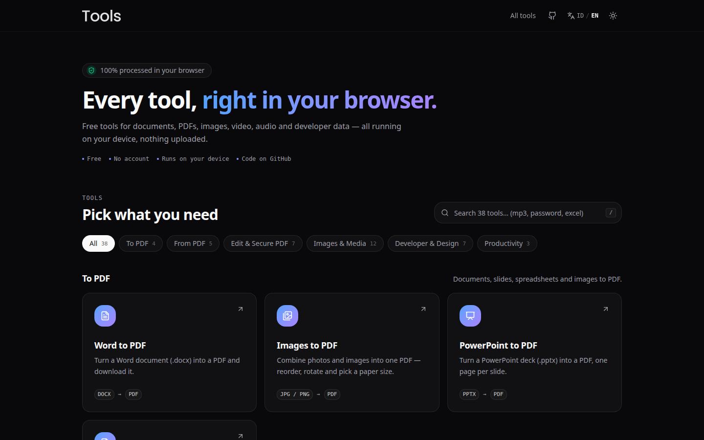

# tools

**English** · [Bahasa Indonesia](README.id.md)

**My everyday file toolbox, built for the file work I do every day and published free for everyone.**
44 tools for PDF, Office files, images, video, audio and QR codes, and every one of them runs entirely in your browser.
Your files are never uploaded.

[](https://chalidade.github.io/tools/)
[](https://github.com/chalidade/tools/actions/workflows/pages.yml)
[](LICENSE)


[](https://chalidade.github.io/tools/)

## Why

Most "free online converters" upload your file to someone else's server. For a contract, a payslip
or an ID scan, that is a bad trade. This site makes one promise and is built around it:
**everything happens on your device.** There is no backend, no account, no upload and no
third-party processing API. Heavy work is done with libraries compiled to WebAssembly or with the
browser's own media encoders, and a library is downloaded only when you open the tool that needs it.

- **Free and open source** (MIT)
- **Bilingual UI**: English and Indonesian, with a toggle in the header
- **Embeddable**: any tool can go on your own site through an iframe, and the first tool is packaged
  as a web component ([below](#embed-a-tool-on-your-site))

## Tools

All 44, grouped the way the home page groups them. Each name links to the live tool.

**To PDF**
- [Word to PDF](https://chalidade.github.io/tools/#/doc-to-pdf): `.docx` to PDF, paginated without cutting through lines of text
- [Images to PDF](https://chalidade.github.io/tools/#/image-to-pdf): reorder, rotate, A4/Letter/fit-to-image; phone EXIF rotation applied
- [PowerPoint to PDF](https://chalidade.github.io/tools/#/ppt-to-pdf): `.pptx` to PDF, one page per slide
- [Excel to PDF](https://chalidade.github.io/tools/#/excel-to-pdf): `.xlsx`/`.csv` to a selectable-text PDF table, with theme colors, borders, merged cells and number formats

**From PDF**
- [PDF to Word](https://chalidade.github.io/tools/#/pdf-to-word): editable `.docx`, keeping font size, bold/italic, tabs and page breaks
- [PDF to Excel](https://chalidade.github.io/tools/#/pdf-to-excel): tables rebuilt from text positions; currencies and percentages become real numbers
- [PDF to PowerPoint](https://chalidade.github.io/tools/#/pdf-to-ppt): one slide per page, with the text as editable text boxes
- [PDF to Images](https://chalidade.github.io/tools/#/pdf-to-image): PNG/JPG at 72, 150 or 300 dpi, zipped when there are several
- [PDF to Markdown](https://chalidade.github.io/tools/#/pdf-to-markdown): headings, emphasis, lists and tables, with tables joined across pages

**Edit & Secure PDF**
- [Merge PDF](https://chalidade.github.io/tools/#/merge-pdf), [Split PDF](https://chalidade.github.io/tools/#/split-pdf) (pages, ranges like `1-3, 5, 8-`, or every N pages)
- [Watermark PDF](https://chalidade.github.io/tools/#/watermark-pdf): text or logo, centred or tiled, correct on rotated pages
- [Sign PDF](https://chalidade.github.io/tools/#/sign-pdf): draw (pressure-sensitive) or upload a signature, then place it anywhere
- [Compress PDF](https://chalidade.github.io/tools/#/compress-pdf): re-encodes embedded JPEGs and optimises the structure with qpdf; never returns a larger file
- [Protect PDF](https://chalidade.github.io/tools/#/protect-pdf) (AES-256 password and permissions) and [Unlock PDF](https://chalidade.github.io/tools/#/unlock-pdf)

**Images & Media**
- [Compress Images](https://chalidade.github.io/tools/#/compress-image): batch JPG/WebP, metadata (including GPS) stripped
- [Crop & Resize Image](https://chalidade.github.io/tools/#/crop-resize-image): free or fixed ratios, rotate, flip, exact pixels
- [Remove Background](https://chalidade.github.io/tools/#/remove-background): magic wand, color select, lasso and brush, with no AI model to download
- [Compress Video](https://chalidade.github.io/tools/#/compress-video): MP4 output using the device's own encoder, with a size estimate up front
- [Trim Video & Audio](https://chalidade.github.io/tools/#/trim-media): filmstrip/waveform timeline; untouched parts are copied without re-encoding
- [GIF ⇄ MP4](https://chalidade.github.io/tools/#/gif-mp4), [Extract Video Frames](https://chalidade.github.io/tools/#/extract-frames)
- [Change Speed](https://chalidade.github.io/tools/#/change-speed): 0.25× to 4× with the pitch kept natural (a hand-written WSOLA time-stretch)
- [Merge Audio](https://chalidade.github.io/tools/#/merge-audio), [Compress Audio](https://chalidade.github.io/tools/#/compress-audio) (MP3, AAC or Opus)
- [Screen Recorder](https://chalidade.github.io/tools/#/screen-recorder): screen, window or tab, with mic and tab audio mixed, a floating camera, and WebM or MP4 export
- [Voice Recorder](https://chalidade.github.io/tools/#/audio-recorder): live waveform, recordings kept in IndexedDB, export to MP3/M4A/WAV

**Music**

- [Guitar Tuner](https://chalidade.github.io/tools/#/guitar-tuner): microphone pitch detection (McLeod method), auto string detection, guitar/bass/ukulele tunings, reference tones, adjustable A4
- [Metronome](https://chalidade.github.io/tools/#/metronome): 30–300 BPM on a lookahead Web Audio scheduler, accents, beats per bar, subdivisions, tap tempo
- [Chord Finder & Transpose](https://chalidade.github.io/tools/#/chords): guitar and ukulele shapes generated for every root and 16 chord types, playable (Karplus–Strong); transposes a pasted song sheet keeping chords aligned to the lyrics
- [BPM & Key Finder](https://chalidade.github.io/tools/#/bpm-key): tempo from an onset-envelope comb search, key from a chromagram against Krumhansl profiles, Camelot code and diatonic chords; runs in a Web Worker
- [Online Piano](https://chalidade.github.io/tools/#/piano): all 88 keys with a minimap and 1–7 octave views; six synthesised voices (grand, electric piano, organ, harpsichord, strings, music box); practice mode with public-domain pieces, scales and any MIDI file you open (parsed in the browser), next-key highlighting, demo playback and a score; multi-touch, computer keyboard, Web MIDI, sustain, chord names
- [Online Guitar](https://chalidade.github.io/tools/#/guitar): Karplus–Strong strings with a fractional-delay all-pass (in tune to ~2 cents) and pick-position excitation, acoustic body / clean / overdriven amp; swipe-to-strum over generated chord shapes, capo, free fretboard, auto accompaniment patterns

**Developer & Design**
- [QR Code Generator](https://chalidade.github.io/tools/#/qr-generator): links, Wi-Fi, WhatsApp, vCard and more, with logo and styles; every code is scanned back to confirm it reads
- [QR & Barcode Reader](https://chalidade.github.io/tools/#/qr-reader): from an image, a pasted screenshot or the camera (QR, Data Matrix, Aztec, PDF417, EAN/UPC, Code 128…)
- [JSON Beautifier](https://chalidade.github.io/tools/#/json-beautify) and [JSON Minify](https://chalidade.github.io/tools/#/json-minify): a custom parser that keeps numbers exactly as written
- [Favicon Generator](https://chalidade.github.io/tools/#/favicon-generator): `.ico`, iOS/Android icons, web manifest and the `<head>` snippet
- [Image ⇄ Base64](https://chalidade.github.io/tools/#/image-to-base64), [Color Picker](https://chalidade.github.io/tools/#/color-picker) (HEX/RGB/HSL/OKLCH, WCAG contrast, 50–950 shades)

**Productivity**
- [Notes](https://chalidade.github.io/tools/#/notes): Markdown with live checklists, saved in the browser, JSON backup/restore
- [Calculator](https://chalidade.github.io/tools/#/calculator): basic and scientific, with its own expression parser (no `eval`)
- [Whiteboard](https://chalidade.github.io/tools/#/whiteboard): pressure-sensitive pen, shapes, text, multiple pages, export to PNG/PDF

The [Indonesian README](README.id.md) has a longer per-tool table with every option and limitation.

## How it works

```
src/
├── tools/
│   ├── registry.ts        one entry per tool: slug, category, icon, keywords, lazy(() => import(...))
│   ├── registry-en.ts     English titles and descriptions
│   └── <slug>/            one folder per tool, default-exported React component
├── lib/                   shared engines: pdf-text, pdf-doc, qpdf, media, image, i18n, routing
└── components/
    ├── tool/              shared tool UI: FileDrop, MediaRange, SizeResult, ...
packages/screen-recorder/  the same tool source built as an npm package / web component
```

- **One folder per tool, one registry entry.** Adding an entry is all it takes: the home-page card,
  the search index and the `#/<slug>` route are all derived from the
  registry. Each tool is `React.lazy`-loaded, and heavy libraries (pdf.js, ExcelJS, Mediabunny…)
  are dynamic `import()`s inside the tool, so the home page never pays for them.
- **Shared engines instead of copy-paste.** PDF text extraction (`lib/pdf-text.ts`) feeds PDF to
  Word, Excel, PowerPoint and Markdown; PDF editing (`lib/pdf-doc.ts`, pdf-lib) handles rotated
  pages and restriction-only encryption for merge, split, watermark and sign; all audio/video goes
  through `lib/media.ts` on Mediabunny.
- **WebAssembly, self-hosted.** qpdf 12 compiled to wasm handles encryption and structural
  optimisation (a fresh module per command, files in its in-memory FS). zxing-wasm reads barcodes,
  with its `.wasm` bundled by Vite instead of fetched from a CDN. MP3 and AAC encoders are wasm
  fallbacks registered only when the browser has no native encoder.
- **Hash routing under `/tools/`.** Routes are `#/<slug>` so a reload on GitHub Pages' sub-path never
  404s and no server rewrite is needed.
- **A light home page.** A short static intro, then the searchable tool grid (press `/` to
  search) grouped by category. No animation library and no per-frame JavaScript, so it opens fast
  even on a phone.
- **Bilingual by construction.** Every string is written in both languages at the point of use
  (`t('Indonesian', 'English')`). English is the default unless the browser language is Indonesian
  or Malay; `?lang=en` in a link forces it.

More detail, including how the npm package isolates its styles in a Shadow DOM, is in
[docs/ARCHITECTURE.md](docs/ARCHITECTURE.md).

## Tech stack

| Area | Libraries |
| --- | --- |
| App | React 19, TypeScript 6, Vite 8, Tailwind CSS v4, shadcn/ui, lucide-react, Geist font |
| PDF | pdf.js (legacy build), pdf-lib, qpdf (wasm), jsPDF + jspdf-autotable |
| Office | docx-preview, docx, ExcelJS + numfmt, pptxgenjs, @jvmr/pptx-to-html, html2canvas-pro, DOMPurify |
| Audio / video | Mediabunny on WebCodecs, @mediabunny/aac-encoder and mp3-encoder (wasm), gifenc, gifuct-js |
| Images / QR | Canvas 2D, zxing-wasm, node-qrcode |
| Music | Web Audio API only — pitch, tempo and key detection and the chord shapes are written in-house |
| Other | marked + DOMPurify (Notes), perfect-freehand (Whiteboard), JSZip |

## Getting started

Requires Node.js 22 (the version CI uses).

```bash
npm ci
npm run dev              # dev server
npm run build            # type-check (tsc -b) + production build
npm run preview          # serve the production build
npm run lint             # oxlint
npm run build:packages   # build the embeddable npm package(s)
npm run og               # re-render the Open Graph image (needs Chrome/Chromium)
```

A local build uses base `/`. To reproduce the GitHub Pages build exactly:

```bash
npx tsc -b && npx vite build --base=/tools/ && npx vite preview --base=/tools/
```

Every push to `main` is built and deployed to GitHub Pages by
[`.github/workflows/pages.yml`](.github/workflows/pages.yml).

## Adding a tool

1. Create `src/tools/<slug>/` with a default-exported component. Reuse the shared UI in
   `src/components/tool/` and keep heavy libraries behind a dynamic `import()`.
2. Add one entry to `src/tools/registry.ts` (category, icon, formats, search keywords, lazy import)
   and its English text to `src/tools/registry-en.ts`.

The one rule: **all processing stays on the client.** No backend, and no sending user files to a
third-party service.

## Quality gates

- **`npm run build` is the gate.** It runs `tsc -b` (strict TypeScript) before `vite build`, and CI
  runs the same type-check before every deploy, so a type error never ships.
- **Lint** with oxlint (`npm run lint`).
- **There is no automated test suite.** Tools are verified by using them and by inspecting the
  files they produce, which has caught bugs a click-through could not (see the lessons below).
- The npm package's hand-written public types are checked against the source at build time
  (`packages/screen-recorder/types/check.ts`).

## Browser support

- **Video and audio tools need WebCodecs.** The UI checks for `VideoEncoder`/`AudioEncoder` first
  and names the browsers that support them when they are missing. AAC falls back to a wasm
  encoder where the browser has none (Firefox, Chrome on Linux); MP3 always uses the wasm encoder.
- **PDF tools use pdf.js's legacy build.** pdf.js 6 relies on very recent JavaScript, and the modern
  build made every PDF tool fail on older Chromium.
- **Screen Recorder** needs a desktop browser (`getDisplayMedia`); it records VP9/Opus WebM, or MP4
  on Safari, and can convert WebM to MP4.
- **Smaller notes:** the Color Picker's screen eyedropper needs the EyeDropper API (Chrome/Edge);
  HEIC images open only in Safari.

**Known limitations**, also stated in each tool: scanned PDFs are not supported (that needs OCR);
legacy `.doc`, `.ppt` and `.xls` are not supported; Excel to PDF and Watermark PDF write text with
PDF's built-in Helvetica, so non-Latin scripts do not render correctly.

## Embed a tool on your site

Any tool can be embedded. `?embed` renders the tool alone, without the site header and footer;
add `&theme=light|dark` and `&lang=en|id` as needed.

```html
<iframe
  src="https://chalidade.github.io/tools/#/screen-recorder?embed&lang=en"
  title="Screen Recorder"
  style="width: 100%; height: 760px; border: 0; border-radius: 16px"
  allow="display-capture; microphone; camera; clipboard-write; fullscreen; picture-in-picture"
></iframe>
```

[`packages/screen-recorder`](packages/screen-recorder) builds the Screen Recorder from the same
source into a `<screen-recorder>` custom element (React and CSS bundled, rendered in a Shadow DOM)
plus a headless API. It is ready to publish to npm as `@chalidade/screen-recorder` but has not been
published yet; until then, use the iframe.

## Engineering notes

Things this project taught me, with the longer write-ups on my [devlog](https://github.com/chalidade/devlog):

- **[Paginating a .docx in the browser without cutting lines](https://github.com/chalidade/devlog/blob/main/notes/paginating-docx-in-the-browser.md).**
  CVs built as one big layout table were sliced through a line of text at the page break. The fix
  measures real rendered lines with `Range.getClientRects()` and moves the cut into a gap; margins
  moved to `@page` so continuation pages keep them.
- **[Rebuilding tables from PDF text](https://github.com/chalidade/devlog/blob/main/notes/rebuilding-tables-from-pdf-text.md).**
  A PDF has no tables, only positioned text. Rows come from shared baselines and columns from
  vertical gutters no text crosses, with a tolerance so one long cell cannot erase a column.
- **[Time-stretching audio in the browser](https://github.com/chalidade/devlog/blob/main/notes/time-stretching-audio-in-the-browser.md).**
  A streaming WSOLA implementation for speed changes without the chipmunk effect, with memory
  bounded no matter how long the file is.
- **Measure the output, not the click-through.** Every tool passed a click-through, yet probing
  the files found a 2× video with 81 frames instead of 120 and a GIF playing 4% fast.
- **File contents are untrusted input.** Slide HTML is sanitised with DOMPurify, the QR reader only
  makes `http(s)`, `mailto`, `tel` and `sms` links clickable, and a crafted-`.docx` XSS in Word to
  PDF (docx-preview rendering embedded HTML in an unsandboxed iframe) was fixed in
  [68db1ae](https://github.com/chalidade/tools/commit/68db1ae).
- **Scope calls follow from the promise.** Background removal uses manual selection tools instead
  of a ~100 MB AI model download, and a YouTube/Instagram downloader was turned down because it
  cannot work without a server-side proxy.

## How this was built

Built with [Claude Code](https://claude.com/claude-code) as the coding assistant. I decided what to
build and where to draw the scope lines, reviewed and merged every change, and tested the tools on
real files and on the outputs they produce.

## License

[MIT](LICENSE) © Chalid Ade Rahman · [chalidade.github.io](https://chalidade.github.io)
