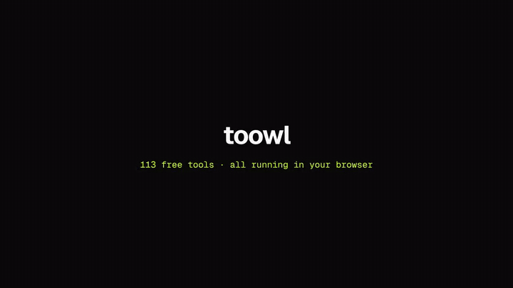
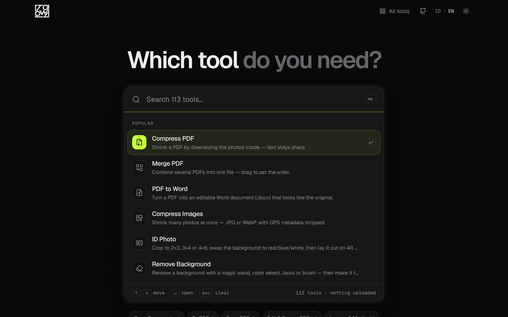
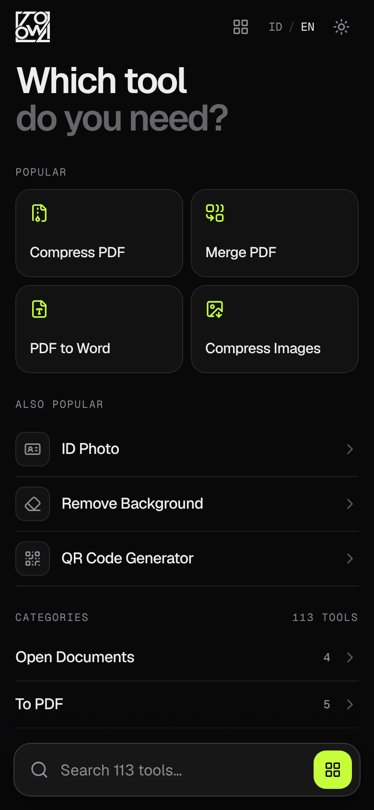

# toowl

**English** · [Bahasa Indonesia](README.id.md)

**My everyday file toolbox, built for the file work I do every day and published free for everyone.**
139 tools for PDF, Office files, CAD drawings, images, video, audio, music and everyday calculations, and every one of them runs entirely in your browser.
Your files are never uploaded.

[](https://toowl.my.id/)
[](https://github.com/chalidade/tools/actions/workflows/pages.yml)
[](LICENSE)


<a href="https://toowl.my.id/en/"></a>

▶ [Watch the 30-second intro (MP4)](docs/intro-en.mp4) · [Bahasa Indonesia version](docs/intro-id.mp4)

<p>
  
  
</p>

## Why

Most "free online converters" upload your file to someone else's server. For a contract, a payslip
or an ID scan, that is a bad trade. This site makes one promise and is built around it:
**everything happens on your device.** There is no backend, no account, no upload and no
third-party processing API. Heavy work is done with libraries compiled to WebAssembly or with the
browser's own media encoders, and a library is downloaded only when you open the tool that needs it.

- **Free and open source** ([AGPL-3.0](#license))
- **One search box**: the home page is a command palette (`/` or Ctrl/⌘+K, arrow keys, Enter); on a phone it is a dock at the bottom, in thumb reach
- **Bilingual UI**: English and Indonesian; every tool has its own address in both (`/<tool>/` and `/en/<tool>/`)
- **Installable app**: add it to a phone's home screen or a desktop ("Install app" in the header); it opens without browser bars, and every tool you have opened once keeps working offline
- **Full screen instruments**: piano, guitar and drums have a full-screen mode that turns a phone sideways
- **Embeddable**: any tool can go on your own site through an iframe, and the first tool is packaged
  as a web component ([below](#embed-a-tool-on-your-site))

## Tools

All 139, grouped the way the site groups them. Each name links to the live tool.

**Open Documents**
- [PDF Reader](https://toowl.my.id/en/pdf-reader/): pages drawn by pdf.js with its text layer on top (select, copy, Ctrl+F), working links, password-protected PDFs, zoom, page jump, full screen
- [Word Reader](https://toowl.my.id/en/word-reader/): `.docx` page by page (docx-preview), zoom and full screen
- [Excel Reader](https://toowl.my.id/en/excel-reader/): `.xlsx`/`.csv` as a grid with column letters, row numbers and sheet tabs; Excel number formats, colours, borders and merged cells
- [PowerPoint Reader](https://toowl.my.id/en/ppt-reader/): `.pptx` slides at their real layout, plus a one-slide-at-a-time presentation mode

Each reader opens the other three formats too.

**To PDF**
- [Word to PDF](https://toowl.my.id/en/doc-to-pdf/): `.docx` to PDF, paginated without cutting through lines of text
- [Images to PDF](https://toowl.my.id/en/image-to-pdf/): reorder, rotate, A4/Letter/fit-to-image; phone EXIF rotation applied
- [DWG to PDF](https://toowl.my.id/en/dwg-to-pdf/): AutoCAD .dwg/.dxf to a vector PDF (LibreDWG in WebAssembly), A4–A0, fit or 1:N scale, colour or black, layer on/off
- [PowerPoint to PDF](https://toowl.my.id/en/ppt-to-pdf/): `.pptx` to PDF, one page per slide
- [Markdown & Text to PDF / Word](https://toowl.my.id/en/markdown-to-pdf/): write or open `.md`/`.txt`, preview the page, download a PDF (image pages, or selectable text via print) or a `.docx` with real headings, lists, tables and code (marked + DOMPurify, reuses the Word to PDF page engine; web images are never loaded)
- [Excel to PDF](https://toowl.my.id/en/excel-to-pdf/): `.xlsx`/`.csv` to a selectable-text PDF table, with theme colors, borders, merged cells and number formats

**From PDF**
- [PDF to Word](https://toowl.my.id/en/pdf-to-word/): editable `.docx`, keeping font size, bold/italic, tabs and page breaks
- [PDF to Excel](https://toowl.my.id/en/pdf-to-excel/): tables rebuilt from text positions; currencies and percentages become real numbers
- [PDF to PowerPoint](https://toowl.my.id/en/pdf-to-ppt/): one slide per page, with the text as editable text boxes
- [PDF to Images](https://toowl.my.id/en/pdf-to-image/): PNG/JPG at 72, 150 or 300 dpi, zipped when there are several
- [PDF to DWG](https://toowl.my.id/en/pdf-to-dwg/): vector lines, circles and text of a PDF into an R12 DXF that AutoCAD opens and saves as .dwg, at a chosen 1:N scale
- [PDF to Markdown](https://toowl.my.id/en/pdf-to-markdown/): headings, emphasis, lists and tables, with tables joined across pages
- [Extract Images from PDF](https://toowl.my.id/en/pdf-extract-images/): every embedded image; JPEGs kept byte for byte, others as PNG (with transparency from soft masks); one by one or as a ZIP; JPEG 2000/JBIG2 are skipped

**Edit & Secure PDF**
- [Merge PDF](https://toowl.my.id/en/merge-pdf/), [Split PDF](https://toowl.my.id/en/split-pdf/) (pages, ranges like `1-3, 5, 8-`, or every N pages)
- [Watermark PDF](https://toowl.my.id/en/watermark-pdf/): text or logo, centred or tiled, correct on rotated pages
- [Organize PDF Pages](https://toowl.my.id/en/organize-pdf/): thumbnails you drag to reorder, rotate, duplicate or delete
- [PDF Page Numbers](https://toowl.my.id/en/page-numbers/): position, format (`1`, `1 / 10`, `Page 1`) and the first numbered page
- [Fill PDF Form](https://toowl.my.id/en/fill-pdf/): fills AcroForm fields (text, checkboxes, dropdowns, radio buttons) beside a page preview; optional flatten to lock the answers; XFA is reported as unsupported
- [Save Paper: Pages per Sheet](https://toowl.my.id/en/pdf-n-up/): 2, 4 or 8 pages per sheet or a fold-in-half booklet, on A4, F4 or Letter; pages are embedded, so text stays sharp
- [Sign PDF](https://toowl.my.id/en/sign-pdf/): draw (pressure-sensitive) or upload a signature, then place it anywhere
- [Ink-Saver PDF](https://toowl.my.id/en/pdf-grayscale/): grayscale or black & white (adjustable threshold, light backgrounds to white) before printing; pages are re-rendered, so text becomes an image
- [Edit PDF](https://toowl.my.id/en/edit-pdf/): add text (font, size, colour), images, boxes, lines, ticks and scribbles on any page of a non-AcroForm form
- [Compress PDF](https://toowl.my.id/en/compress-pdf/): re-encodes embedded JPEGs and optimises the structure with qpdf; never returns a larger file
- [ZIP: Make & Open](https://toowl.my.id/en/zip/): bundle files or a folder into a ZIP (JSZip, none/normal/max compression), or open a ZIP and take files one by one
- [Redact PDF](https://toowl.my.id/en/redact-pdf/): drag to mark areas; those pages are re-rendered with the areas blacked out, so the original text is really removed
- [Protect PDF](https://toowl.my.id/en/protect-pdf/) (AES-256 password and permissions) and [Unlock PDF](https://toowl.my.id/en/unlock-pdf/)

**Images & Media**
- [Image to SVG](https://toowl.my.id/en/image-to-svg/): trace a logo, icon, sticker or signature from PNG/JPG into a vector SVG with VTracer (wasm), in colour or black & white, with curve/polygon modes and speckle filtering
- [Upscale Image](https://toowl.my.id/en/upscale-image/): 2× or 4× with Real-ESRGAN (realesr-general-x4v3) on ONNX Runtime Web, WebGPU or WebAssembly, tiled
- [Compress Images](https://toowl.my.id/en/compress-image/): batch JPG/WebP, optional "max N KB" size limit, metadata (including GPS) stripped
- [Crop & Resize Image](https://toowl.my.id/en/crop-resize-image/): free or fixed ratios, rotate, flip, exact pixels
- [Convert Image Format](https://toowl.my.id/en/convert-image/): HEIC (iPhone), WebP, AVIF, PNG, JPG to JPG/PNG/WebP, in batches; HEIC decoded by a self-hosted libheif wasm
- [ARW to JPG](https://toowl.my.id/en/arw-to-jpg/): develop Sony RAW (ARW) — and CR2/CR3, NEF, RAF, ORF, RW2, DNG — to full-size JPG/PNG with LibRaw (wasm) and the camera's white balance; falls back to the embedded camera JPG where the browser lacks shared wasm memory
- [Image to DNG](https://toowl.my.id/en/image-to-dng/): JPG/PNG/HEIC to a LinearRaw DNG (16-bit linear sRGB, lossless-JPEG tiles, linear profile) that Lightroom, Photoshop and Snapseed open; the page explains why "JPG to ARW" is not possible
- [ID Photo](https://toowl.my.id/en/pas-foto/): 2×3 / 3×4 / 4×6 crop, red/blue/white backdrop, 4R or A4 print sheet (JPG/PNG/PDF)
- [ID Document Watermark](https://toowl.my.id/en/watermark-ktp/): tiled "only for verification" text with the date over an ID photo, size/angle/opacity adjustable, re-saved without EXIF
- [Censor Photo](https://toowl.my.id/en/sensor-foto/): box or brush over ID numbers, faces or plates; black block (default), pixelate or blur, with a warning that light blur on small text can be guessed
- [Remove Photo Metadata](https://toowl.my.id/en/strip-exif/): shows camera, date and GPS; JPG/PNG are cleaned losslessly
- [Remove Background](https://toowl.my.id/en/remove-background/): one-tap AI cut-out (U²-Net-P on ONNX Runtime Web, downloaded only when used), plus magic wand, color select, lasso and brush to tidy up; transparent, blurred or colored background
- [Signature to PNG](https://toowl.my.id/en/signature-png/): draw or photograph a signature, remove the paper and specks, recolour the ink, download a transparent PNG
- [Document Scanner](https://toowl.my.id/en/scan/): photograph paper, drag the four corners (found automatically as a first guess), straighten the perspective on a canvas without OpenCV, pick black-and-white, grayscale or color, and combine pages into one PDF (pdf-lib)
- [OCR — Photo to Text](https://toowl.my.id/en/ocr/): Indonesian and English text from photos and screenshots with Tesseract (wasm); the worker, core and language data are bundled with the site, never fetched from a CDN, and loaded only when you press Read text
- [Compress Video](https://toowl.my.id/en/compress-video/): MP4 output using the device's own encoder, with a size estimate up front
- [Subtitle SRT ⇄ VTT](https://toowl.my.id/en/subtitle/): shift late/early subtitles, stretch for another frame rate, merge two files, convert SRT ⇄ VTT, preview over your own video
- [Trim Video & Audio](https://toowl.my.id/en/trim-media/): filmstrip/waveform timeline; untouched parts are copied without re-encoding
- [Split Video for WhatsApp Status](https://toowl.my.id/en/status-wa/): cuts a long video into equal 15/30/60 s parts, each re-encoded under 16 MB, with a ZIP of all parts
- [Photo Collage](https://toowl.my.id/en/kolase/): 2–9 photos in grid, strip or one-big layouts, spacing, rounded corners, 1:1 / 4:5 / 9:16, JPG or PNG
- [Photos to Video](https://toowl.my.id/en/foto-ke-video/): photos plus optional music to an MP4 for Status, Reels or TikTok, with order, time per photo, fade, slow zoom and 9:16 / 1:1 / 16:9
- [Split Photo for Grid & Carousel](https://toowl.my.id/en/grid-instagram/): one photo into 3, 6 or 9 Instagram tiles or seamless carousel slides, with upload order, JPG/PNG or ZIP
- [GIF ⇄ MP4](https://toowl.my.id/en/gif-mp4/), [Extract Video Frames](https://toowl.my.id/en/extract-frames/)
- [Change Speed](https://toowl.my.id/en/change-speed/): 0.25× to 4× with the pitch kept natural (a hand-written WSOLA time-stretch)
- [Noise Remover](https://toowl.my.id/en/denoise/): removes background noise, hiss and hum from voices in video or audio with DeepFilterNet 3 or RNNoise (self-hosted wasm), latency compensated so lips stay in sync
- [Add Music to Video](https://toowl.my.id/en/add-music/): background music under a video with volume, loop, fade and automatic ducking when someone talks
- [Merge Audio](https://toowl.my.id/en/merge-audio/), [Compress Audio](https://toowl.my.id/en/compress-audio/) (MP3, AAC or Opus)
- [Screen Recorder](https://toowl.my.id/en/screen-recorder/): screen, window or tab, with mic and tab audio mixed, a floating camera, and WebM or MP4 export
- [Voice Recorder](https://toowl.my.id/en/audio-recorder/): live waveform, recordings kept in IndexedDB, export to MP3/M4A/WAV

**Music**

- [Guitar Tuner](https://toowl.my.id/en/guitar-tuner/): microphone pitch detection (McLeod method), auto string detection, guitar/bass/ukulele/violin/viola/cello tunings, reference tones, continuous drone, adjustable A4
- [Metronome](https://toowl.my.id/en/metronome/): 30–300 BPM on a lookahead Web Audio scheduler, accents, beats per bar, subdivisions, tap tempo
- [Chord Finder & Transpose](https://toowl.my.id/en/chords/): guitar and ukulele shapes generated for every root and 16 chord types, playable (Karplus–Strong); transposes a pasted song sheet keeping chords aligned to the lyrics
- [Chord Progression Builder](https://toowl.my.id/en/chord-progression/): 12 patterns (pop, 50s, canon, ii–V–I, 12-bar blues, minor loops) in any key built from the chord dictionary's generated shapes; plays on the guitar or piano synth with a lookahead scheduler, transposes by semitone, opens the chords in Online Guitar
- [Practice Recorder](https://toowl.my.id/en/practice-recorder/): raw microphone take over a lookahead metronome (the click is never recorded), count-in bar, playback with the click laid back on top and a nudge for latency, MP3/M4A/WAV export through Mediabunny
- [BPM & Key Finder](https://toowl.my.id/en/bpm-key/): tempo from an onset-envelope comb search, key from a chromagram against Krumhansl profiles, Camelot code and diatonic chords; runs in a Web Worker
- [Online Piano](https://toowl.my.id/en/piano/): all 88 keys with a minimap and 1–7 octave views; six synthesised voices (grand, electric piano, organ, harpsichord, strings, music box); practice mode with public-domain pieces, scales and any MIDI file you open (parsed in the browser), next-key highlighting, demo playback and a score; multi-touch, computer keyboard, Web MIDI, sustain, chord names
- [Online Guitar](https://toowl.my.id/en/guitar/): Karplus–Strong strings with a fractional-delay all-pass (in tune to ~2 cents) and pick-position excitation, acoustic body / clean / overdriven amp; swipe-to-strum over generated chord shapes, capo, free fretboard, auto accompaniment patterns
- [Online Drums](https://toowl.my.id/en/drums/): nine synthesised pads (808-style metal for hats and cymbals, hi-hat choke), multi-touch with centre-is-louder velocity, keyboard, General MIDI e-drum input; 16-step sequencer with accents, swing and nine preset grooves, saved in the browser

**Developer & Design**
- [QR Code Generator](https://toowl.my.id/en/qr-generator/): links, Wi-Fi, WhatsApp, vCard and more, with logo and styles; every code is scanned back to confirm it reads
- [QR & Barcode Reader](https://toowl.my.id/en/qr-reader/): from an image, a pasted screenshot or the camera (QR, Data Matrix, Aztec, PDF417, EAN/UPC, Code 128…)
- [JSON Beautifier](https://toowl.my.id/en/json-beautify/) and [JSON Minify](https://toowl.my.id/en/json-minify/): a custom parser that keeps numbers exactly as written
- [Favicon Generator](https://toowl.my.id/en/favicon-generator/): `.ico`, iOS/Android icons, web manifest and the `<head>` snippet
- [Image ⇄ Base64](https://toowl.my.id/en/image-to-base64/), [Color Picker](https://toowl.my.id/en/color-picker/) (HEX/RGB/HSL/OKLCH, WCAG contrast, 50–950 shades)
- [CSV ⇄ JSON](https://toowl.my.id/en/csv-json/) (comma, semicolon or tab detected), [YAML ⇄ JSON](https://toowl.my.id/en/yaml-json/) (errors with line and column, multi-document), [SQL Formatter](https://toowl.my.id/en/sql-formatter/) (MySQL, PostgreSQL, SQLite, SQL Server, BigQuery)
- [Hash Generator](https://toowl.my.id/en/hash/): MD5 and SHA-1/256/384/512 of text or multi-GB files, hashed in 4 MB slices in a worker, with a checksum check
- [Regex Tester](https://toowl.my.id/en/regex/): live highlights, capture groups, replace, examples; matching runs in a worker with a time limit so a runaway pattern can't freeze the tab
- [Minify HTML/CSS/JS](https://toowl.my.id/en/minify/): Terser, CSSO and an in-house HTML minifier, sizes before/after/gzipped, plus beautify
- [Unix Timestamp](https://toowl.my.id/en/timestamp/), [Cron Explainer](https://toowl.my.id/en/cron/) (in-house parser, sentences in both languages, next runs, builder)
- [Color Contrast Checker](https://toowl.my.id/en/kontras-warna/) (WCAG 2.2 AA/AAA with the nearest passing colour), [Lorem Ipsum](https://toowl.my.id/en/lorem-ipsum/), [Screenshot Mockup](https://toowl.my.id/en/mockup/) (browser, phone and laptop frames drawn from shapes)

**Productivity**
- [Merge & Split Excel/CSV](https://toowl.my.id/en/merge-excel/): stack many files or sheets into one (columns matched by title, optional source column) or split a sheet by the values of a column into sheets or a ZIP of `.xlsx`/`.csv`
- [Notes](https://toowl.my.id/en/notes/): Markdown with live checklists, saved in the browser, JSON backup/restore
- [Calculator](https://toowl.my.id/en/calculator/): basic and scientific, with its own expression parser (no `eval`)
- [Encrypt & Decrypt File](https://toowl.my.id/en/encrypt-file/): lock any file with a password (WebCrypto AES-256-GCM, PBKDF2-SHA-256 600k iterations, random salt), original name kept inside; forgotten passwords cannot be recovered
- [Document Vault](https://toowl.my.id/en/brankas/): keep ID, KK, BPJS and policy photos/PDFs in this browser (IndexedDB), encrypted per file with AES-256-GCM (PBKDF2-SHA-256 600k iterations, fresh IV each), auto-locks when the tab is hidden, encrypted backup/restore as one file; forgotten passwords cannot be recovered
- [Password Generator](https://toowl.my.id/en/password-generator/): random passwords and Indonesian/English passphrases from `crypto.getRandomValues`, plus a strength check with estimated guessing time
- [Word Counter](https://toowl.my.id/en/word-counter/): words, characters, sentences, paragraphs, reading/speaking time and per-platform character limits
- [Unit Converter](https://toowl.my.id/en/unit-converter/): length, weight (ons, quintal), area (hectare, are, tumbak), volume, temperature, speed and data
- [Date Calculator](https://toowl.my.id/en/date-calculator/): exact age, days between dates, working days with bundled Indonesian public holidays, add/subtract time
- [Prayer Times](https://toowl.my.id/en/jadwal-sholat/): daily and monthly times from a bundled city list or GPS, computed from the sun's position (Kemenag angles: Fajr 20°, Isha 18°, Asr 1×, 2-minute margin), printable; no API
- [Qibla Direction](https://toowl.my.id/en/arah-kiblat/): great-circle bearing to the Kaaba plus a live phone compass via `DeviceOrientationEvent` (iOS permission, calibration warning)
- [Hijri ⇄ Gregorian Converter](https://toowl.my.id/en/hijriah/): through the browser's `islamic-umalqura` Intl calendar, plus a year of Islamic holidays; notes that official Kemenag dates may differ by a day
- [Zakat Calculator](https://toowl.my.id/en/zakat/): income, wealth, gold/silver and fitrah zakat; nisab from a gold price you enter (nothing fetched), formulas shown
- [Used Phone/Laptop Check](https://toowl.my.id/en/cek-perangkat/): tick through screen (dead pixels), touch, speaker, mic, camera, vibration, sensor and keyboard tests, then copy a summary
- [Digital Tasbih](https://toowl.my.id/en/tasbih/): big tap counter with 33/99/free/custom targets, vibration at the target, keyboard shortcuts, history in localStorage
- [Number to Words](https://toowl.my.id/en/terbilang/): numbers to Indonesian or English words with rupiah/sen suffix and letter-case options
- [QRIS Amount](https://toowl.my.id/en/qris/): read your shop's static QRIS (image or camera) and add an amount (tag 54, dynamic flag, CRC-16 recomputed) for a ready-to-scan QR; PNG/SVG
- [Letter Generator](https://toowl.my.id/en/surat/): job application, absence, power of attorney, statement and resignation letters as PDF (pdf-lib) or Word (docx), last entry kept on the device
- [CV Builder](https://toowl.my.id/en/cv/): one-column, ATS-friendly CV with real text and standard headings, reorderable sections, three layouts, Indonesian and English samples, PDF (pdf-lib) or Word (docx), data in localStorage and JSON export/import
- [Case Converter](https://toowl.my.id/en/ubah-huruf/): UPPERCASE, lowercase, Title Case, Sentence case, collapse extra spaces, remove blank lines, join lines; one tap, then copy
- [Selling Price & Cost Calculator](https://toowl.my.id/en/harga-jual/): unit cost from a production run, then the price from a target margin or markup after fees, discount and tax you enter; profit per unit and break-even, last entry kept on the device
- [Shipping Labels](https://toowl.my.id/en/label-pengiriman/): sender saved once, recipients pasted from Excel/CSV, labels several per A4 sheet, one per A6 page or 100 × 150 mm stickers as PDF (pdf-lib)
- [Receipt & Invoice](https://toowl.my.id/en/kwitansi/): PDF receipt or invoice with items, discount and tax, amount in words from Terbilang, last entry kept on the device (pdf-lib)
- [Loan Instalment Calculator](https://toowl.my.id/en/cicilan/): flat or annuity interest, month-by-month schedule, total interest, CSV export
- [GPA Calculator](https://toowl.my.id/en/ipk/): semester GPA and cumulative GPA from credits × letter grades (A/AB/B or A/A-/B+ scale), "what average do I need for GPA X" simulation, weighted report-card average, saved on the device
- [Weton Calculator](https://toowl.my.id/en/weton/): date → Javanese market day (Legi/Pahing/Pon/Wage/Kliwon), neptu, wuku and Javanese date, plus finding dates for a given weton; calendar arithmetic only, checked against known dates
- [NIK Checker](https://toowl.my.id/en/cek-nik/): reads the 16-digit NIK layout (province, regency, district from a bundled 2025 region table, birth date, sex = day + 40 for women); format only, nothing stored or sent
- [Savings & Investment Calculator](https://toowl.my.id/en/tabungan/): compound interest on a deposit (compounding frequency, optional 20% interest tax), regular monthly saving, monthly amount for a target, SVG growth chart and year table
- [Bill Split](https://toowl.my.id/en/patungan/): split a group bill per item or equally, tax and service shared proportionally, exact rounding (largest remainder), summary for WhatsApp
- [Random Draw & Arisan](https://toowl.my.id/en/undian/): unbiased `crypto.getRandomValues` name draw with a short animation, arisan mode that excludes earlier winners until everyone has had a turn, history in localStorage
- [Islamic Inheritance Calculator](https://toowl.my.id/en/kalkulator-waris/): faraid shares for every heir, who is excluded, 'aul and radd, rupiah per person
- [Take-Home Pay Calculator](https://toowl.my.id/en/gaji-bersih/): gross to net salary with PPh 21 (Article 17 brackets, PTKP), BPJS health, JHT and pension; rates in one source file
- [Electricity Token Calculator](https://toowl.my.id/en/token-listrik/): PLN prepaid amount to estimated kWh by tariff class after PPJ, admin fee and VAT, with days left from daily use; tariffs in one source file
- [THR & Overtime Calculator](https://toowl.my.id/en/thr-lembur/): full or prorated THR and PP 35/2021 overtime (working day vs holiday, 5- or 6-day week) with an hour-by-hour breakdown; rules in one source file
- [WhatsApp Link](https://toowl.my.id/en/link-wa/): number (08…, +62…) and optional message to a `wa.me` chat link, copy button and QR (reuses the QR generator); the number is remembered only if you ask
- [Percentage & Discount Calculator](https://toowl.my.id/en/persen/): X% of Y, what percent, percent change and stacked discounts with a step table (50% + 20% = 60%)
- [Which Is Cheaper](https://toowl.my.id/en/mana-lebih-murah/): compare packs on one unit price (g/kg/ml/L/pcs, pieces per pack), cheapest marked with the percent difference
- [Encode / Decode](https://toowl.my.id/en/encode-decode/): Base64 (UTF-8, URL-safe), URL encode, HTML entities and JWT decoding (header + payload, no signature check)
- [UUID Generator](https://toowl.my.id/en/uuid/): v4 and time-ordered v7 from `crypto.getRandomValues`, up to 1000 at once, with format options
- [Text Compare](https://toowl.my.id/en/text-diff/): line and word diff with colours, unified or side by side
- [Whiteboard](https://toowl.my.id/en/whiteboard/): pressure-sensitive pen, shapes, text, multiple pages, export to PNG/PDF
- [Pregnancy Due Date Calculator](https://toowl.my.id/en/hpl/): due date from the last period (Naegele's rule, adjustable cycle) or an ultrasound, with gestational age, trimester and milestones; an estimate only
- [BMI & Ideal Weight](https://toowl.my.id/en/bmi/): BMI with Asia-Pacific, Kemenkes or WHO categories, healthy weight range and daily calories (Mifflin-St Jeor); cut-offs in one data file

**Emergency**
- [SOS & Flashlight](https://toowl.my.id/en/sos/): phone torch (Chrome Android) blinking Morse SOS, flashing white screen, siren from Web Audio, plain flashlight mode, screen Wake Lock; screen only on iPhone
- [Emergency Info](https://toowl.my.id/en/darurat/): Indonesian emergency numbers as `tel:` buttons (list and check date in one data file), and GPS location as text with a map link via Share or WhatsApp, with accuracy shown
- [Medical ID Card (ICE)](https://toowl.my.id/en/kartu-medis/): blood type, allergies, medication, conditions and emergency contact kept on the device, exported as a lock screen wallpaper PNG with the card placed below the clock area
- [CPR Guide](https://toowl.my.id/en/cpr/): 100–120/min beat (metronome click), 30 : 2 or hands-only count, short illustrated steps, call-112-first reminder, Wake Lock; follows AHA/PMI and is not a substitute for training
- [First Aid Guide](https://toowl.my.id/en/p3k/): illustrated step cards for choking (incl. infants), burns, bleeding, fainting, seizures, snake bites and fractures; 112/119 button always visible; text and sources in one data file, follows PMI/WHO and is not a substitute for training
- [Fake Call](https://toowl.my.id/en/panggilan-palsu/): mock incoming-call screen with custom caller name, Web Audio ringtone and vibration, instant or timed, full screen with Wake Lock and a running call timer

The [Indonesian README](README.id.md) has a longer per-tool table with every option and limitation.

## How it works

```
src/
├── tools/
│   ├── registry.ts        one entry per tool: slug, category, icon, keywords, lazy(() => import(...))
│   ├── registry-en.ts     English titles and descriptions
│   └── <slug>/            one folder per tool, default-exported React component
├── lib/                   shared engines: pdf-text, pdf-doc, qpdf, media, image, i18n, routing
└── components/
    ├── tool/              shared tool UI: FileDrop, MediaRange, SizeResult, ...
packages/screen-recorder/  the same tool source built as an npm package / web component
```

- **One folder per tool, one registry entry.** Adding an entry is all it takes: the home-page card,
  the search index, the `/<slug>/` and `/en/<slug>/` pages and the sitemap are all derived from
  the registry. Each tool is `React.lazy`-loaded, and heavy libraries (pdf.js, ExcelJS, Mediabunny…)
  are dynamic `import()`s inside the tool, so the home page never pays for them.
- **Shared engines instead of copy-paste.** PDF text extraction (`lib/pdf-text.ts`) feeds PDF to
  Word, Excel, PowerPoint and Markdown; PDF editing (`lib/pdf-doc.ts`, pdf-lib) handles rotated
  pages and restriction-only encryption for merge, split, watermark and sign; all audio/video goes
  through `lib/media.ts` on Mediabunny.
- **WebAssembly, self-hosted.** qpdf 12 compiled to wasm handles encryption and structural
  optimisation (a fresh module per command, files in its in-memory FS). zxing-wasm reads barcodes,
  with its `.wasm` bundled by Vite instead of fetched from a CDN. MP3 and AAC encoders are wasm
  fallbacks registered only when the browser has no native encoder.
- **Real addresses for search engines.** Every tool has `/<slug>/` (Indonesian) and `/en/<slug>/`
  (English); the address decides the language. `scripts/seo.mjs` writes an `index.html` per page
  with its own title, description, `hreflang` and JSON-LD, plus `sitemap.xml` and `404.html`, so a
  reload on static hosting never 404s. Old `#/<slug>` links are rewritten on load.
- **A fast, one-box home page.** On a laptop it is a command palette that lists recent and popular
  tools; on a phone, tiles and categories with a search dock at the bottom. The full catalogue
  lives at [`/all/`](https://toowl.my.id/en/all/). Motion is CSS only: no animation library and
  no per-frame JavaScript.
- **Design.** Near-black with one acid-lime accent, Geist sans and mono served from the site
  itself (never a font CDN), dark by default with a light theme in the header.
- **Bilingual by construction.** Every string is written in both languages at the point of use
  (`t('Indonesian', 'English')`).

More detail, including how the npm package isolates its styles in a Shadow DOM, is in
[docs/ARCHITECTURE.md](docs/ARCHITECTURE.md).

## Tech stack

| Area | Libraries |
| --- | --- |
| App | React 19, TypeScript 6, Vite 8, Tailwind CSS v4, shadcn/ui, lucide-react, Geist font (self-hosted) |
| PDF | pdf.js (legacy build), pdf-lib, qpdf (wasm), jsPDF + jspdf-autotable |
| Office | docx-preview, docx, ExcelJS + numfmt, pptxgenjs, @jvmr/pptx-to-html, html2canvas-pro, DOMPurify |
| Audio / video | Mediabunny on WebCodecs, @mediabunny/aac-encoder and mp3-encoder (wasm), gifenc, gifuct-js |
| Images / QR | Canvas 2D, VTracer (wasm), ONNX Runtime Web + Real-ESRGAN, libheif (wasm), Tesseract (wasm), zxing-wasm, node-qrcode |
| CAD | LibreDWG (wasm, via `@mlightcad/libredwg-web`), own DXF writer |
| Noise removal | DeepFilterNet 3 and RNNoise (wasm, self-hosted) |
| Music | Web Audio API only — pitch, tempo and key detection and the chord shapes are written in-house |
| Other | marked + DOMPurify (Notes), perfect-freehand (Whiteboard), JSZip |

## Getting started

Requires Node.js 22 (the version CI uses).

```bash
npm ci
npm run dev              # dev server
npm run build            # type-check (tsc -b) + production build
npm run preview          # serve the production build
npm run lint             # oxlint
npm run build:packages   # build the embeddable npm package(s)
npm run og               # re-render the Open Graph image (needs Chrome/Chromium)
npm run build:ios        # build for the iOS app and copy it into ios/ (then open it in Xcode on a Mac)
```

The iOS app (App Store) bundles this same build with Capacitor; build, signing and
submission are described in [docs/IOS.md](docs/IOS.md).

The site is served from the domain root (custom domain `toowl.my.id` on GitHub Pages), so a local
build matches production. Every push to `main` is built and deployed by
[`.github/workflows/pages.yml`](.github/workflows/pages.yml).

## Adding a tool

1. Create `src/tools/<slug>/` with a default-exported component. Reuse the shared UI in
   `src/components/tool/` and keep heavy libraries behind a dynamic `import()`.
2. Add one entry to `src/tools/registry.ts` (category, icon, formats, search keywords, lazy import)
   and its English text to `src/tools/registry-en.ts`.

The one rule: **all processing stays on the client.** No backend, and no sending user files to a
third-party service.

## Quality gates

- **`npm run build` is the gate.** It runs `tsc -b` (strict TypeScript) before `vite build`, and CI
  runs the same type-check before every deploy, so a type error never ships.
- **Lint** with oxlint (`npm run lint`).
- **There is no automated test suite.** Tools are verified by using them and by inspecting the
  files they produce, which has caught bugs a click-through could not (see the lessons below).
- The npm package's hand-written public types are checked against the source at build time
  (`packages/screen-recorder/types/check.ts`).

## Browser support

- **Video and audio tools need WebCodecs.** The UI checks for `VideoEncoder`/`AudioEncoder` first
  and names the browsers that support them when they are missing. AAC falls back to a wasm
  encoder where the browser has none (Firefox, Chrome on Linux); MP3 always uses the wasm encoder.
- **PDF tools use pdf.js's legacy build.** pdf.js 6 relies on very recent JavaScript, and the modern
  build made every PDF tool fail on older Chromium.
- **Screen Recorder** needs a desktop browser (`getDisplayMedia`); it records VP9/Opus WebM, or MP4
  on Safari, and can convert WebM to MP4.
- **Smaller notes:** the Color Picker's screen eyedropper needs the EyeDropper API (Chrome/Edge);
  HEIC images open only in Safari.

**Known limitations**, also stated in each tool: the PDF converters need a text layer, so scanned PDFs
come out as images (use [OCR](https://toowl.my.id/en/ocr/) on a photo or screenshot instead);
legacy `.doc`, `.ppt` and `.xls` are not supported; Excel to PDF and Watermark PDF write text with
PDF's built-in Helvetica, so non-Latin scripts do not render correctly.

## Embed a tool on your site

Any tool can be embedded. `?embed` renders the tool alone, without the site header and footer;
add `&theme=light|dark` and `&lang=en|id` as needed.

```html
<iframe
  src="https://toowl.my.id/#/screen-recorder?embed&lang=en"
  title="Screen Recorder"
  style="width: 100%; height: 760px; border: 0; border-radius: 16px"
  allow="display-capture; microphone; camera; clipboard-write; fullscreen; picture-in-picture"
></iframe>
```

[`packages/screen-recorder`](packages/screen-recorder) builds the Screen Recorder from the same
source into a `<screen-recorder>` custom element (React and CSS bundled, rendered in a Shadow DOM)
plus a headless API. It is ready to publish to npm as `@chalidade/screen-recorder` but has not been
published yet; until then, use the iframe.

## Engineering notes

Things this project taught me, with the longer write-ups on my [devlog](https://github.com/chalidade/devlog):

- **[Paginating a .docx in the browser without cutting lines](https://github.com/chalidade/devlog/blob/main/notes/paginating-docx-in-the-browser.md).**
  CVs built as one big layout table were sliced through a line of text at the page break. The fix
  measures real rendered lines with `Range.getClientRects()` and moves the cut into a gap; margins
  moved to `@page` so continuation pages keep them.
- **[Rebuilding tables from PDF text](https://github.com/chalidade/devlog/blob/main/notes/rebuilding-tables-from-pdf-text.md).**
  A PDF has no tables, only positioned text. Rows come from shared baselines and columns from
  vertical gutters no text crosses, with a tolerance so one long cell cannot erase a column.
- **[Time-stretching audio in the browser](https://github.com/chalidade/devlog/blob/main/notes/time-stretching-audio-in-the-browser.md).**
  A streaming WSOLA implementation for speed changes without the chipmunk effect, with memory
  bounded no matter how long the file is.
- **Measure the output, not the click-through.** Every tool passed a click-through, yet probing
  the files found a 2× video with 81 frames instead of 120 and a GIF playing 4% fast.
- **File contents are untrusted input.** Slide HTML is sanitised with DOMPurify, the QR reader only
  makes `http(s)`, `mailto`, `tel` and `sms` links clickable, and a crafted-`.docx` XSS in Word to
  PDF (docx-preview rendering embedded HTML in an unsandboxed iframe) was fixed in
  [68db1ae](https://github.com/chalidade/tools/commit/68db1ae).
- **Scope calls follow from the promise.** Background removal uses manual selection tools instead
  of a ~100 MB AI model download, and a YouTube/Instagram downloader was turned down because it
  cannot work without a server-side proxy.

## How this was built

Built with [Claude Code](https://claude.com/claude-code) as the coding assistant. I decided what to
build and where to draw the scope lines, reviewed and merged every change, and tested the tools on
real files and on the outputs they produce.

## License

[AGPL-3.0-only](LICENSE) © Chalid Ade Rahman · [chalidade.github.io](https://chalidade.github.io)

In short: you may use, study, change and share the code, including commercially, but if you
distribute it or run a modified version for others over a network (a site, an app, an embedded
package), you must publish your complete source under the AGPL too. Embedding a tool from
toowl.my.id with an `<iframe>` does not put your own site under the AGPL.

**Commercial licence.** If you want to use toowl's code in a closed-source product without the
AGPL's obligations, a commercial licence is available; contact me through
[GitHub](https://github.com/chalidade). It cannot cover the third-party GPL code noted below.

**Earlier versions.** Everything up to and including commit
[43c1e4a](https://github.com/chalidade/tools/commit/43c1e4a) (19 November 2026) was released under
the MIT licence and stays available under MIT; later changes are AGPL-3.0-only.

Bundled third-party pieces keep their own licences: the DWG/DXF reader used by DWG to PDF is
[LibreDWG](https://www.gnu.org/software/libredwg/) via `@mlightcad/libredwg-web` (GPL-3.0), and
Upscale Image runs Real-ESRGAN's `realesr-general-x4v3` model (BSD-3-Clause). Remove Background's one-tap mode runs U²-Net-P (`u2netp.onnx`, Apache-2.0, from the rembg release).
